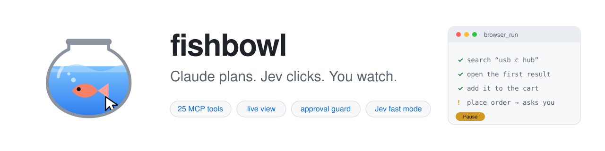
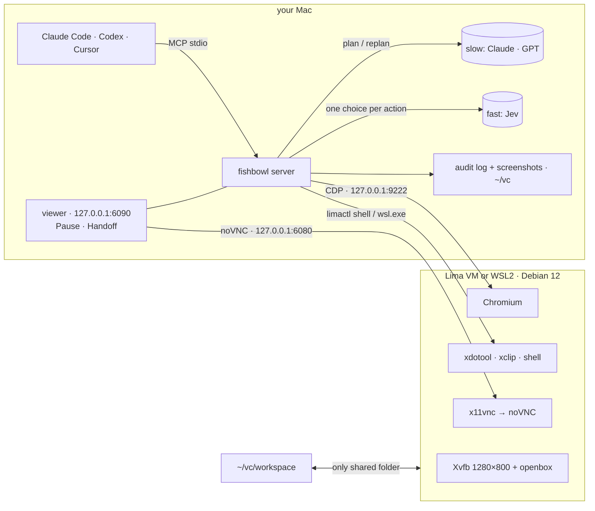

<a id="readme-top"></a>

<div align="center">

<picture>
  <source media="(prefers-color-scheme: dark)" srcset="docs/banner-dark.svg">
  
</picture>

# fishbowl-jev-ultrafast

**Give your AI agent its own computer, and watch everything it does.**

A sandboxed Linux desktop on your Mac or Windows PC that Claude Code, Codex, Claude Desktop or Cursor drive through 25 MCP tools.
<br>You watch it live, pause it with one click, and take over for logins. Optional **fast mode**: Claude plans, and [Jev](https://github.com/browser-use/jev-ultrafast) executes each click.

**English** · [简体中文](README.zh-CN.md)

[](https://github.com/ericwang915/fishbowl/actions/workflows/ci.yml)
[](https://github.com/ericwang915/fishbowl/releases)
[](LICENSE)


[](https://github.com/ericwang915/fishbowl/stargazers)

[](docs/)
[](docs/tools.md)
[](docs/fast-slow.md)
[](docs/security.md)
[](https://github.com/ericwang915/fishbowl/discussions)

<br>


<sub>A real <code>browser_run</code> recording: fast thinking makes one choice per action, dismisses the cookie wall, and
<b>stops before the irreversible "Place order" to ask you</b>. (<a href="scripts/make_demo.py">Recorded</a> with the scripted test model.)</sub>

</div>

<br>

> [!NOTE]
> **v0.1, early.** In CI, `fishbowl up` boots the real VM (Lima + KVM on Linux) and live tests pass against it: screenshots,
> pixel clicks, Unicode typing, clipboard, isolation, `browser_run`. The test suite also runs on macOS (Apple Silicon and Intel)
> and Windows. Not yet run: the VM on a physical Mac, WSL on Windows, and live Jev calls. [Reports from your machine](https://github.com/ericwang915/fishbowl/issues/new/choose) are very welcome.

<details>
<summary><b>Table of contents</b></summary>

- [Quick start](#-quick-start)
- [Platforms](#-platforms)
- [What can it do?](#-what-can-it-do)
- [Why fishbowl?](#-why-fishbowl)
- [Fast mode: Claude plans, Jev executes](#-fast-mode-claude-plans-jev-executes)
- [Features](#-features)
- [Use it from your agent](#-use-it-from-your-agent)
- [Architecture](#-architecture)
- [Configuration](#-configuration)
- [Tested](#-tested)
- [FAQ](#-faq)
- [Roadmap](#-roadmap)
</details>

## 🚀 Quick start

**1. Install the VM runtime**, then fishbowl

| macOS (Apple Silicon or Intel) | Windows 10/11 (x64 or ARM) | Linux |
|---|---|---|
| `brew install lima`<br>Intel Macs also: `brew install qemu` | `wsl --install` in an admin PowerShell, reboot<br>(WSL 2.4.4+; update with `wsl --update`) | [Lima](https://lima-vm.io/docs/installation/) + QEMU/KVM |

```bash
pip install git+https://github.com/ericwang915/fishbowl
```

**2. Create the VM.** The first boot downloads Debian and installs a desktop, which takes about 5 minutes.

```bash
fishbowl up
```

**3. Connect your agent.** This finds Claude Code, Codex, Claude Desktop and Cursor, and registers fishbowl with each one it finds.

```bash
fishbowl install
```

**4. Check, then ask.**

```console
$ fishbowl doctor
fishbowl 0.1.0
  ✓ limactl installed
  ✓ VM 'fishbowl' running
  ✓ Chromium CDP on http://127.0.0.1:9222
  ✓ noVNC on 127.0.0.1:6080
  ✓ workspace /Users/you/vc/workspace
  · fast thinking: off — set TYPESAFE_API_KEY to execute with Jev (or FISHBOWL_FAST=anthropic|openai|ollama)
  · slow thinking: off — set ANTHROPIC_API_KEY or OPENAI_API_KEY (or FISHBOWL_SLOW=ollama)
All good.
```

> *Use fishbowl to open news.ycombinator.com and summarise the top 3 posts.*

A tab opens in your browser with the VM's screen, and you watch the agent work. **No API key is needed.** To turn on
[fast mode](#-fast-mode-claude-plans-jev-executes), set `export TYPESAFE_API_KEY=…` and reconnect the MCP server.

## 💻 Platforms

One desktop (Debian 12, Xvfb 1280×800, Chromium, noVNC), provisioned by the same scripts everywhere:

| Host | VM | Isolation | Verified |
|---|---|---|---|
| **macOS · Apple Silicon** | Lima + Apple Virtualization (`vz`, virtiofs) | only `~/vc/workspace` mounted; ports on 127.0.0.1 | test suite in CI; VM boot not yet |
| **macOS · Intel** | Lima + QEMU | same | test suite in CI; VM boot not yet |
| **Windows 10/11 · x64 (Intel / AMD) or ARM** | WSL2 distro with systemd | no Windows drives (only the workspace via fstab), no Windows interop, unprivileged user | test suite in CI (x64); WSL boot not yet |
| **Linux · x86_64 / arm64** | Lima + QEMU/KVM (sshfs mount) | same as macOS | ✅ **VM boot + live tests in CI** |

`fishbowl doctor` shows which host and backend it detected.

## 💡 What can it do?

Copy any of these into Claude Code or Codex once fishbowl is connected:

| | Try asking | What happens |
|---|---|---|
| 🔎 | *"Open the pricing pages of Linear, Height and Jira, and put a comparison table in /workspace/pricing.md."* | The agent browses in the VM, and the file appears in `~/vc/workspace` on your Mac |
| 🔐 | *"Open x.com. If I'm not logged in, hand me the screen. Then save my last 20 bookmarks to /workspace/bookmarks.csv."* | `handoff` gives you the screen to log in. The session persists for next time |
| 📝 | *"Fill the vendor form at ‹url› with the details in /workspace/vendor.json, but don't submit."* | Fields are typed straight into the page; the guard stops any submit until you approve |
| 💬 | *"Ask the support bot on ‹store› each question in /workspace/questions.txt, grade every reply, and write results.csv."* | `chat_ask` and `judge_reply` label each answer: no reply, survey only, wrong language, not actionable… |
| ⚡ | *"Use browser_run with goal: find a USB-C hub under $50 on ‹shop› and add it to the cart."* | Fast mode: Claude plans, Jev executes, and it stops before checkout |
| 🖥️ | *"Install ffmpeg in the VM and turn /workspace/clip.mov into a GIF."* | `shell` runs inside the VM, never on your Mac |

> [!TIP]
> Drop [`examples/AGENTS.md`](examples/AGENTS.md) into your project (Codex reads `AGENTS.md`; copy it into `CLAUDE.md`
> for Claude Code). It teaches the agent the house rules: prefer `browser_*` over pixel clicks, plan with
> `browser_run`, use `handoff` for logins, and never work around the guard.

## 🤔 Why fishbowl?

Computer-use agents are powerful and a little scary. Usually you choose between letting the agent loose on your
real machine and running a headless browser you can't see. fishbowl takes a third route:

| | Agent on your real Mac | Headless browser / Playwright MCP | **fishbowl** |
|---|:---:|:---:|:---:|
| Can't touch your files or accounts | ❌ | ✅ | ✅ VM sees only `~/vc/workspace` |
| You can watch it live | ✅ | ❌ | ✅ noVNC in your browser |
| Pause and take over mid-task | awkward | ❌ | ✅ one click, plus `handoff` |
| Full desktop, not just a browser | ✅ | ❌ | ✅ xdotool + shell |
| Asks before paying, sending or deleting | ❌ | ❌ | ✅ approval guard |
| Record of everything it did | ❌ | ❌ | ✅ JSONL audit log + screenshots |
| Long web tasks without big-model tokens | ❌ | ❌ | ✅ fast mode: Claude plans, Jev executes |

## ⚡ Fast mode: Claude plans, Jev executes

Big models are good at deciding *what* to do and slow at clicking through a page. fishbowl splits the work:

```
 slow thinking   Claude / GPT / your agent
   goal ─► plan: [{goal: "search for it", text: "usb c hub"}, {goal: "open the first result"}, …]
                                  │                                     ▲
                                  ▼                                     │  handback + page observation
 fast thinking   Jev
   per action, ONE request:  operation?  click_target?  type_target?  select_target?
   → freshness check → act → "is this step done?" → next step
```

| | What it means |
|---|---|
| **One request per action** | Jev answers the operation *and* a target for each operation in one round trip. Each operation only offers compatible elements, and dropdown options are chosen directly |
| **One browser call per observation** | Elements, visible text, overlays and change markers are read in a single `Runtime.evaluate` |
| **Fresh or not at all** | The freshness check runs in the same round trip as the hit test, so a stale decision is never executed |
| **The fast model never writes text** | Every string it types was written into the plan by the slow thinker |
| **`DONE` is verified** | A separate question checks the claim. Stuck, unsure or blocked? It hands back with a page observation, and the slow model replans |

| You set | What works |
|---|---|
| nothing | Everything except `browser_run`: your agent drives with the `browser_*` tools step by step, and the guard uses keyword rules |
| `TYPESAFE_API_KEY` | **Fast mode**: `browser_run(plan=…)` runs on Jev, and so do the guard and `judge_reply` |
| + `ANTHROPIC_API_KEY` or `OPENAI_API_KEY` | `browser_run(goal=…)`: fishbowl plans and replans by itself (Claude Sonnet / GPT-4.1) |

When Claude Code or Codex drive fishbowl, **they already are the slow thinker**: they pass a `plan`, and only Jev
is needed.

```jsonc
// you plan (what Claude Code and Codex do)
{"plan": [{"goal": "search for the product", "text": "usb c hub"}, {"goal": "open the first result"}]}
// fishbowl plans, and replans when stuck
{"goal": "find a USB-C hub under $50 and add it to the cart"}
// both: start from your plan, and let the planner rescue it
{"goal": "…", "plan": [ … ], "max_replans": 2}
```

Results are `done`, `handback`, `needs_approval`, `paused` or `timeout`, with a reason, a per-step log (operation,
target, confidence) and timing. **[Read the design →](docs/fast-slow.md)**

<details><summary><b>Use a different fast model, or run fully local</b></summary>

Fast mode turns on automatically only with Jev. Other models can be chosen explicitly. The same multiple-choice
questions become an enum-constrained JSON schema, so the model can only pick options that exist.

```bash
export FISHBOWL_FAST=ollama FISHBOWL_FAST_MODEL=qwen3:8b       # local fast model
export FISHBOWL_SLOW=ollama FISHBOWL_SLOW_MODEL=qwen3:32b      # local planner
export FISHBOWL_FAST=openai OPENAI_BASE_URL=https://openrouter.ai/api/v1 FISHBOWL_FAST_MODEL=…   # OpenAI-compatible
```
</details>

## ✨ Features

<table>
<tr><td width="50%" valign="top">

### 🔒 Isolated and local-first
- Lima VM (macOS, Linux) or WSL2 (Windows): Debian 12, a 1280×800 desktop, Chromium and a shell
- The only shared folder is `~/vc/workspace`; on Windows, drives and Windows programs are switched off
- Ports are bound to **127.0.0.1**, and every other guest port is ignored
- Append-only audit log of every action, with secrets redacted
- Screenshots are kept for 7 days

</td><td width="50%" valign="top">

### 👀 Human in the loop
- The live viewer opens on the first action, never twice
- **Pause / Resume** in the corner of the viewer
- `handoff("please log in")`: you get the screen, and the agent waits until you click **Done**
- The clipboard bridge never touches disk. Your Mac clipboard enters the VM only while *you* have the screen,
  and is wiped when you hand it back

</td></tr>
<tr><td valign="top">

### 🛡️ Approval guard
- Before every click or Enter, the guard asks whether the action is irreversible, or visible to others
- Paying, sending, deleting, submitting or publishing needs your OK, through MCP elicitation or `needs_approval`
- Card numbers (Luhn-checked) and API keys are **never** typed
- Without fast mode, or if the model is down, multilingual keyword rules take over: it **fails closed**

</td><td valign="top">

### 🧰 Precise browser control
- Element tables with role, name, value, checked state and screen coordinates
- Text goes straight into the field, after checking it is still there and **not covered**
- Finds modals and cookie walls, and the buttons that close them
- Waits for the page to settle; tabs a site opens never steal the working tab
- Unicode typing on the desktop too (é, 中文, emoji)

</td></tr>
<tr><td valign="top">

### 💬 Chatbot QA
- `chat_ask` sends a question, confirms it was posted, and waits for the reply to settle, ignoring *Thinking…* or
  *Sedang mengetik…*
- Labels each outcome: `answered` · `no_reply` · `survey_only` · `placeholder_stuck` · `send_failed`
- `judge_reply` grades the reply type, language match, whether it is actionable, and whether it cites store data, with a 1–5 score
- `model_stats`: calls, tokens, latency and spend

</td><td valign="top">

### 🔁 Built to live with
- Works with MCP SDK 1.x and 2.x, on Python 3.10+
- Progress notifications keep long runs alive in clients with per-call timeouts
- Tells the client to reconnect when fishbowl is upgraded under a running session
- `fishbowl doctor`: VM, CDP, noVNC, and which thinking modes are on
- [All 25 tools →](docs/tools.md)

</td></tr>
</table>

<p align="right"><a href="#readme-top">back to top ↑</a></p>

## 🔌 Use it from your agent

`fishbowl install` finds your MCP clients and registers fishbowl with each of them. To target one client, run
`fishbowl install --client <name>`. It never writes API keys to config files.

| Client | `--client` | Notes |
|---|---|---|
| **Claude Code** | `claude-code` | user scope; check with `/mcp` |
| **Codex** | `codex` | sets `tool_timeout_sec = 900`, and forwards your keys via `env_vars` |
| **Claude Desktop** | `claude-desktop` | restart the app afterwards |
| **Cursor** | `cursor` | |
| anything else | `print` | prints a standard stdio JSON snippet |

<details><summary><b>Manual config (any MCP client)</b></summary>

```json
{
  "mcpServers": {
    "fishbowl": { "command": "fishbowl", "args": ["mcp"] }
  }
}
```

Use the absolute path from `which fishbowl` if your client starts servers with a minimal `PATH`. Per-client details
are in [docs/clients.md](docs/clients.md).
</details>

## 🧱 Architecture



The security model, including what fishbowl does *not* protect against, is in [docs/security.md](docs/security.md).

## 🔧 Configuration

Everything works with the defaults. Set these environment variables to change behaviour:

| Variable | Default | What it does |
|---|---|---|
| `TYPESAFE_API_KEY` | — | Turns on fast mode with Jev |
| `ANTHROPIC_API_KEY` / `OPENAI_API_KEY` | — | Turns on the planner for `browser_run(goal=…)` |
| `FISHBOWL_FAST`, `FISHBOWL_FAST_MODEL` | `jev`, `jev-latest` | Fast model: `jev`, `anthropic`, `openai` or `ollama` |
| `FISHBOWL_SLOW`, `FISHBOWL_SLOW_MODEL` | from your keys | Planner: `anthropic`, `openai` or `ollama` |
| `FISHBOWL_LLM_BASE_URL` | provider default | Custom endpoint (OpenRouter, vLLM, LM Studio…) |
| `FISHBOWL_PRICE_IN` / `FISHBOWL_PRICE_OUT` | — | USD per 1M tokens, so `model_stats` tracks spend |
| `FISHBOWL_GUARD` | `model` | `model`, `heuristic` (keyword rules only) or `off` |
| `FISHBOWL_HOME` | `~/vc` | Workspace, audit log, screenshots and state |
| `FISHBOWL_SCREENSHOT_DAYS` | `7` | Screenshot retention |
| `FISHBOWL_AUTO_OPEN` | `1` | Open the live viewer on the first action |
| `FISHBOWL_VM` | `fishbowl` | Lima instance / WSL distro name |
| `FISHBOWL_VM_TYPE` | `vz` (Apple Silicon), `qemu` (Intel, Linux) | Force a Lima VM type |
| `FISHBOWL_MOUNT_TYPE` | `virtiofs` (vz), `reverse-sshfs` (QEMU) | Force a Lima mount type |
| `FISHBOWL_CDP_PORT` / `FISHBOWL_NOVNC_PORT` / `FISHBOWL_CONTROL_PORT` | `9222` / `6080` / `6090` | Local ports, all on 127.0.0.1 |
| `FISHBOWL_EXECUTOR` | `lima` (macOS, Linux), `wsl` (Windows) | `local` runs commands on this host (CI) |

<details><summary><b>CLI reference</b></summary>

```
fishbowl up | down | destroy --yes          VM lifecycle
fishbowl view                               open the live viewer
fishbowl doctor                             health checks, and which thinking modes are on
fishbowl status | logs | stats              state, audit log, model usage and spend
fishbowl install [--client X] [--remove]    register with Claude Code, Codex, Claude Desktop or Cursor
fishbowl mcp                                run the MCP server on stdio
```
</details>

## ✅ Tested

**170+ tests on real headless Chrome** on Linux, macOS (Apple Silicon and Intel) and Windows, across Python 3.10 and 3.12
and MCP SDK 1.x and 2.x. CI also runs a live X desktop, and **boots the real VM** with `fishbowl up` and tests against it.
No VM or API key is needed to run the suite:

```bash
pip install -e ".[dev]" && pytest
```

<details><summary><b>What the suites cover</b></summary>

| Suite | Covers |
|---|---|
| `browser_run`: 27 tasks across 9 types | search · forms · dropdowns · checkboxes and radios · cookie walls · scrolling and lazy loading · in-page tabs · slow pages · sites opening their own tabs |
| Handback paths | no change ×3 · login wall · guard refusal · human approval · secret in plan · pause · low confidence · timeout · an answer outside the offered options |
| Fast + slow thinking | goal-only planning · replanning · the planner asking for missing info · `DONE` rejected by verification · stale decisions re-decided · fast mode off without Jev |
| Providers | Jev `systemone` (multiple choice, retry on overload, invalid choices rejected) · enum-constrained Anthropic, OpenAI and Ollama |
| Real VM (CI) | `fishbowl up` on Lima + KVM, then: 1280×800 screenshots · pixel clicks (measured offset) · Unicode typing · clipboard · unprivileged user · only the workspace shared · only CDP and noVNC forwarded · `browser_run` |
| Live desktop (CI) | screenshots · pixel clicks landing on elements · Unicode typing · the clipboard bridge with real xclip |
| Platforms | host detection · Lima on Apple Silicon / Intel / Linux · WSL isolation config and setup sequence · provisioning scripts parse · per-OS client paths · Windows clipboard |
| Guard | keyword fallback: 100% recall and 0% false blocks on 30 labelled actions plus a 10-action holdout · secret and card detection |
| MCP clients | a real stdio handshake (spawn, list 25 tools, call them) · `fishbowl install` merging, idempotency and removal for all four clients |
</details>

**Speed of the fast path** (27-task suite, same scripted model, so only the engine differs):

| | v0.1.0 | now |
|---|---:|---:|
| browser round trips | 581 | **419** (−28%) |
| wall time | 45.5 s | **≈35.6 s** (−22%) |

CI replaces both models with a deterministic stand-in. To measure **your** fast model on the same 27 tasks, run
`python examples/live_eval.py`.

## ❓ FAQ

<details><summary><b>Do I need an API key?</b></summary>

No. Without keys, your agent drives the VM with the step-by-step tools, and the guard uses keyword rules. A Jev key
(`TYPESAFE_API_KEY`) turns on fast mode. An Anthropic or OpenAI key additionally lets `browser_run` plan from a goal.
</details>

<details><summary><b>Is it free?</b></summary>

fishbowl is MIT-licensed and runs on your Mac. Model calls are billed by their providers (TypeSafe for Jev, Anthropic,
OpenAI), unless you run Ollama locally. `model_stats` shows calls, tokens and spend.
</details>

<details><summary><b>What is Jev, and why is it the fast model?</b></summary>

Jev is TypeSafe's structured decision model. It answers multiple-choice questions with calibrated probabilities, in a
single request, which is exactly the shape of "which operation, on which element?". See
[browser-use/jev-ultrafast](https://github.com/browser-use/jev-ultrafast). Other models can be used explicitly. Measure
them on your own tasks with `examples/live_eval.py`.
</details>

<details><summary><b>Can it log into Gmail, X, and other sites?</b></summary>

Through `handoff`: you type the credentials in the live view yourself, so the agent never sees them, and the session
persists in the VM's Chromium profile. Google sometimes refuses sign-in from browsers it considers automated. That
is outside fishbowl's control.

> [!IMPORTANT]
> Use dedicated accounts for agent work. Anything the VM is logged into, the agent can use.
</details>

<details><summary><b>What about captchas and 2FA?</b></summary>

The fast layer hands back when it sees a login wall or captcha, and the agent calls `handoff`. You solve it in the live
view and click **Done**.
</details>

<details><summary><b>Can the agent reach my files?</b></summary>

Only what you put in `~/vc/workspace`. Nothing else on your Mac is mounted. See [the security model](docs/security.md).
</details>

<details><summary><b>How do I reset everything?</b></summary>

`fishbowl destroy --yes && fishbowl up` gives you a fresh VM, and logs you out of everything. Your `~/vc/workspace` is
kept; delete `~/vc` to remove the audit log and screenshots too.
</details>

<details><summary><b>How is this different from browser-use or a Docker computer-use demo?</b></summary>

fishbowl is an MCP server for the agent you already use, not a new agent. It wraps a persistent, watchable VM with
live takeover, an approval guard and an audit log, and borrows jev-ultrafast's execution ideas for its optional fast
mode.
</details>

<details><summary><b>Which computers does it run on?</b></summary>

macOS on Apple Silicon or Intel, Windows 10/11 on x64 (Intel or AMD) or ARM, and Linux. See [Platforms](#-platforms) for
what each uses and what has been verified. On Intel Macs, `fishbowl up` uses QEMU, because Apple's Virtualization.framework
did not boot the VM in our testing.
</details>

<details><summary><b>Why WSL2 on Windows, and is it isolated?</b></summary>

WSL2 is a real Linux VM that ships with Windows. By default it can see every drive and start Windows programs, so
fishbowl turns both off in `/etc/wsl.conf`, mounts only `~\vc\workspace`, and runs the desktop as an unprivileged user.
</details>

<details><summary><b>Can I skip the VM?</b></summary>

On Linux, start the desktop with `scripts/desktop-services.sh` and run with `FISHBOWL_EXECUTOR=local`. The CI desktop job
does exactly this. You lose the VM's isolation.
</details>

<p align="right"><a href="#readme-top">back to top ↑</a></p>

## 🧭 Roadmap

- [x] Real VM boot verified in CI (Linux + KVM)
- [ ] Verified first boot on Apple Silicon, Intel Macs and WSL, and a prebuilt image for faster setup
- [ ] Published `browser_run` benchmark on Jev and local models
- [ ] Session recording (MP4) next to the audit log
- [ ] Egress allow-list for the VM
- [ ] PyPI release (`pip install fishbowl-mcp`)

Have an idea? [Start a discussion](https://github.com/ericwang915/fishbowl/discussions).

## 🤝 Contributing

PRs are welcome, especially new `browser_run` task pages, and guard or chat phrases in more languages. See
[CONTRIBUTING.md](CONTRIBUTING.md) for the dev setup; tests run without a VM or API key.

<a href="https://github.com/ericwang915/fishbowl/graphs/contributors">
  
</a>

## ⭐ Star history

<a href="https://star-history.com/#ericwang915/fishbowl&Date">
  <picture>
    <source media="(prefers-color-scheme: dark)" srcset="https://api.star-history.com/svg?repos=ericwang915/fishbowl&type=Date&theme=dark">
    
  </picture>
</a>

## 🙏 Credits

The fast path adapts ideas from [browser-use/jev-ultrafast](https://github.com/browser-use/jev-ultrafast) (MIT): the
indexed per-operation action space, the single observation call, freshness checks before input, and independent
`DONE` verification. Built on [Lima](https://github.com/lima-vm/lima), [WSL](https://github.com/microsoft/WSL), [noVNC](https://github.com/novnc/noVNC), and the
[Model Context Protocol](https://modelcontextprotocol.io).

<br>

<div align="center">

**Claude plans. Jev clicks. You watch.**

If fishbowl keeps an agent from going off the rails for you, a ⭐ helps others find it.

<sub>MIT License · <a href="docs/security.md">Security</a> · <a href="CHANGELOG.md">Changelog</a></sub>

</div>
