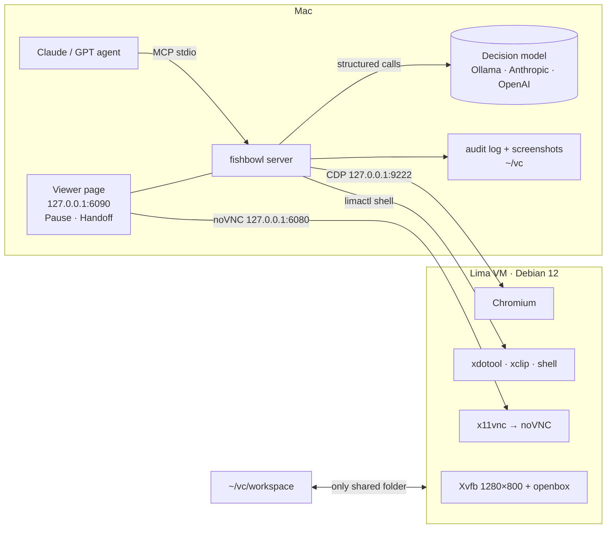

<div align="center">

# 🐠 fishbowl

**Give your AI agent its own Linux computer, and watch everything it does.**

A local VM on your Mac with a 1280×800 Debian desktop, Chromium and a shell. Your agent drives it through 25 MCP tools.
You watch it live in your browser, pause it with one click, and take over when it hits a login or a captcha.

[](https://github.com/ericwang915/fishbowl/actions/workflows/ci.yml)
[](LICENSE)


</div>

```bash
brew install lima
pip install fishbowl-mcp
fishbowl up          # boots the VM (first run ~5 min)
fishbowl install     # registers the MCP server with Claude Code
```

Then ask Claude: *"Open Hacker News in fishbowl and summarise the top 3 posts."* A browser tab opens on your Mac showing
the VM screen, and you watch the agent work.

---

## Why fishbowl?

Computer-use agents are powerful and a little scary. Most setups make you choose: let the agent loose on your real
machine, or run a headless browser you can't see. fishbowl takes a third route:

| | Your real Mac | Headless browser / Playwright MCP | **fishbowl** |
|---|---|---|---|
| Agent can break your stuff | 😬 yes | no | **no**: separate VM, and it only sees `~/vc/workspace` |
| You can watch it live | yes | ❌ | **✅ noVNC in your browser** |
| You can pause / take over | awkward | ❌ | **✅ Pause button + `handoff` for logins and captchas** |
| Full desktop (not just a browser) | yes | ❌ | **✅ xdotool + shell** |
| Network exposure | n/a | varies | **every port bound to 127.0.0.1** |
| Record of what happened | ❌ | ❌ | **✅ JSONL audit log of every action + screenshots** |
| Cost of long web tasks | big-model tokens | big-model tokens | **cheap**: `browser_run` runs plans with a small or local model |

## What you get

**🔒 Isolation and local-first by design**
- The VM sees exactly one Mac folder: `~/vc/workspace` (mounted at `/workspace`).
- CDP and noVNC are forwarded to **127.0.0.1 only**. Every other guest port is explicitly ignored.
- Every tool call goes to `~/vc/audit/YYYY-MM-DD.jsonl`, with secrets redacted. Screenshots are kept for 7 days.

**👀 Human in the loop, for real**
- The live viewer opens automatically on the first action, and never opens a second copy if one is already open.
- **Pause / Resume** sits in the bottom-left corner of the viewer. While paused, every screen-touching tool refuses to act.
- `handoff("please log in")` gives you the screen and blocks until you click **Done**. You can leave a note for the agent.
- The clipboard syncs both ways between your Mac and the VM.

**⚡ Two layers of control**
- **Base layer**: `computer` (pixel clicks and typing with xdotool, plus screenshots) and `browser_*` over CDP. These read page
  text and clickable elements (role, name, value, checked state, screen coordinates), spot popups covering the page, wait for
  the page to settle, and manage tabs.
- **Fast layer**: your big model writes a plan, and `browser_run` executes it locally with a cheap structured decision model:
  - **One decision per action**: the element table goes in, and `{action, element}` comes out (click, type, select, scroll, wait, done, handback).
  - **A separate small check** answers "is this step done?", given the text that newly appeared after the action.
  - **Typed text only comes from the plan.** The model picks *where* to type, never *what*.
  - **Direct input**: text goes straight into the element after checking it is still there and not covered by anything.
  - **Hands control back** after 3 actions that change nothing, a login wall, low confidence, a pause, or a timeout.
  - **Stays on its tab**: tabs a site opens on its own never pull the run away.

**🛡️ Approval guardrail**
- Before a click or Enter, the decision model asks whether the action is irreversible or visible to others: paying, sending,
  deleting, submitting, publishing. If it is, a human must approve. fishbowl uses MCP elicitation when the client supports it,
  and otherwise returns `needs_approval` so the agent can ask you.
- Card numbers (Luhn-checked) and API keys are **always** blocked from being typed, whatever the plan says.
- If the model is unreachable, a multilingual keyword check (English, Chinese, Indonesian) takes over, so the guard **fails closed**.

**💬 Built for chatbot QA**
- `chat_ask` sends one question, confirms it really appeared in the conversation, and waits for the reply to settle. It
  ignores placeholders like *Thinking…*, *Analyzing…* and *Sedang mengetik…*, and labels the outcome: `answered`,
  `no_reply`, `survey_only` (the bot only showed a "rate this chat" prompt), `placeholder_stuck` or `send_failed`.
- `judge_reply` grades the reply: reply type, whether the language matches, whether it is actionable, whether it cites store
  data, and a 1–5 score. Replies with no answer are labelled by rule, with no model call.
- `model_stats` reports calls, tokens, latency and spend for each purpose.

**🔁 Upgrade-aware**: if fishbowl is updated on disk while an MCP process is still running the old code, every tool
result carries a notice telling the client to reconnect.

## Bring your own model (or run fully local)

The fast layer and the guard use a **structured decision model**, separate from the agent that drives fishbowl.
Choose any of these:

| Provider | Setup | Notes |
|---|---|---|
| **Ollama** (local, free) | `ollama pull qwen3:8b` | Default when no API key is set. Uses Ollama's native JSON-schema output. |
| **Anthropic** | `export ANTHROPIC_API_KEY=…` | Default model `claude-haiku-5-5`, called as a forced tool call |
| **OpenAI** | `export OPENAI_API_KEY=…` | Default model `gpt-4.1-mini`, with `json_schema` output |
| **Any OpenAI-compatible API** | `FISHBOWL_LLM=openai FISHBOWL_LLM_BASE_URL=…` | OpenRouter, Groq, DeepSeek, vLLM, LM Studio… Falls back to JSON mode automatically. |

```bash
export FISHBOWL_LLM=ollama            # anthropic | openai | ollama (auto-detected if unset)
export FISHBOWL_MODEL=qwen3:8b        # any model the provider serves
export FISHBOWL_PRICE_IN=0.8          # optional: USD per 1M tokens, so model_stats can track spend
export FISHBOWL_PRICE_OUT=4
```

## The 25 tools

| Group | Tools |
|---|---|
| Desktop | `computer` · `shell` · `clipboard_get` · `clipboard_set` |
| Human in the loop | `view_screen` · `handoff` · `control_status` |
| Browser (CDP) | `browser_open` · `browser_read` · `browser_elements` · `browser_click` · `browser_type` · `browser_select` · `browser_scroll` · `browser_press` · `browser_overlays` · `browser_wait` · `browser_tabs` · `browser_tab` · `browser_back` |
| Fast execution | `browser_run` |
| Chatbot QA | `chat_ask` · `judge_reply` · `model_stats` |
| Accountability | `audit_log` |

### Example: a `browser_run` plan

```json
{
  "plan": [
    {"goal": "search for the product", "text": "usb c hub"},
    {"goal": "open the first result"},
    {"goal": "select 'Space Gray' as the colour"},
    {"goal": "add it to the cart"}
  ]
}
```

The run returns `done`, or `handback` / `needs_approval` / `paused` / `timeout` with a reason and a step-by-step log, so
the driving model knows exactly where to pick up.

## Architecture



## CLI

```
fishbowl up | down | destroy --yes   # VM lifecycle
fishbowl view                        # open the live viewer
fishbowl doctor                      # health checks (VM, CDP, noVNC, model)
fishbowl status | logs | stats
fishbowl install [--client print]    # register with Claude Code, or print the JSON for other clients
fishbowl mcp                         # run the MCP server on stdio
```

<details><summary>Claude Desktop / Cursor / other MCP clients</summary>

```json
{
  "mcpServers": {
    "fishbowl": { "command": "fishbowl", "args": ["mcp"], "env": { "FISHBOWL_LLM": "ollama" } }
  }
}
```
</details>

## Tests

```bash
pip install -e ".[dev]" && pytest
```

The suite runs against real headless Chrome and local test pages. CI uses a deterministic stand-in for the decision
model, so it needs no API key:

- `browser_run`: **27 tasks across 9 types**, all passing. The types are search, multi-field forms, dropdowns,
  checkboxes and radios, cookie walls, scrolling and lazy loading, in-page tabs, slow pages, and sites that open their own tabs.
- `browser_run` handback paths: no change ×3, login wall, guard refusal, human approval, secret in plan, pause, low
  confidence, timeout, and a model trying to type text the plan never gave it.
- `browser_*` base layer: 14 tests, including refusing to click a covered element.
- `chat_ask`: answered, Indonesian placeholder, survey-only, no reply, send failed, secrets blocked.
- Guard fallback: 100% recall and 0% false blocks on a 30-action labelled set plus a 10-action holdout.
- Provider adapters for Anthropic, OpenAI-compatible APIs and Ollama, the audit log, the viewer and pause server, two-way
  clipboard sync, and VM isolation settings.

Run the same task suite against a **real** model: `python examples/live_eval.py` (uses your `FISHBOWL_LLM` settings).

## FAQ

**Does it work on Intel Macs?** Yes. Lima picks the right Debian image for Apple Silicon and Intel.

**Where do logins persist?** In the VM's Chromium profile, so you log in once by handoff and stay logged in.

**Can the agent reach my files?** Only what you put in `~/vc/workspace`.

**Linux host?** Run the services yourself and set `FISHBOWL_EXECUTOR=local FISHBOWL_CDP_URL=…`.

## License

MIT
