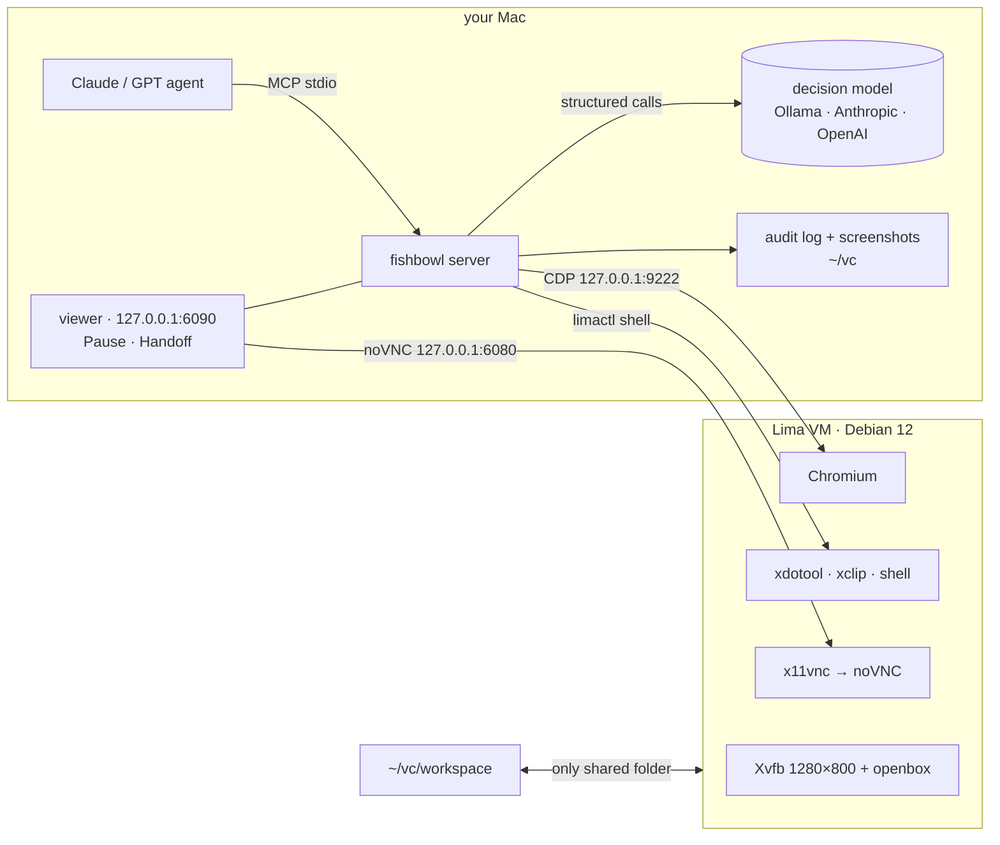

<div align="center">


# fishbowl

### Give your AI agent its own computer. Watch everything it does.

A sandboxed Linux desktop on your Mac that Claude, GPT or a local model drives through **25 MCP tools**.<br>
You watch live in your browser, pause it with one click, and take over for logins and captchas.

[](https://github.com/ericwang915/fishbowl/actions/workflows/ci.yml)
[](LICENSE)


[](https://github.com/astral-sh/ruff)

[**Quick start**](#-quick-start) · [**Why**](#-why-fishbowl) · [**Features**](#-features) · [**Models**](#-bring-your-own-model-or-run-fully-local) · [**Tools**](docs/tools.md) · [**Security**](docs/security.md)


<sub>A real <code>browser_run</code> recording: the agent writes a 4-step plan, the local decision model executes it,
<br>dismisses the cookie wall, and <b>stops before the irreversible "Place order" to ask you</b>. (<a href="scripts/make_demo.py">how it's recorded</a>)</sub>

</div>

---

## ⚡ Quick start

```bash
brew install lima
pip install git+https://github.com/ericwang915/fishbowl
fishbowl up        # creates the VM (first boot ~5 min)
fishbowl install   # registers the MCP server with Claude Code
```

Then ask your agent:

> *Use fishbowl to open news.ycombinator.com and summarise the top 3 posts.*

A tab opens on your Mac showing the VM's screen, and you watch the agent work. Run `fishbowl doctor` if anything looks off.

<details>
<summary><b>Claude Desktop, Cursor and other MCP clients</b></summary>

```json
{
  "mcpServers": {
    "fishbowl": { "command": "fishbowl", "args": ["mcp"], "env": { "FISHBOWL_LLM": "ollama" } }
  }
}
```

`fishbowl install --client print` prints this snippet with the right path for your machine.
</details>

## 🤔 Why fishbowl?

Computer-use agents are powerful and a little scary. Usually you choose between letting the agent loose on your
real machine and running a headless browser you can't see. fishbowl takes a third route:

| | Agent on your real Mac | Headless browser / Playwright MCP | **fishbowl** |
|---|:---:|:---:|:---:|
| Can't touch your files or accounts | ❌ | ✅ | ✅ VM sees only `~/vc/workspace` |
| You can watch it live | ✅ | ❌ | ✅ noVNC in your browser |
| Pause and take over mid-task | awkward | ❌ | ✅ one click, plus `handoff` |
| Full desktop, not just a browser | ✅ | ❌ | ✅ xdotool + shell |
| Asks before paying, sending or deleting | ❌ | ❌ | ✅ approval guard |
| Record of everything it did | ❌ | ❌ | ✅ JSONL audit log + screenshots |
| Long web tasks without big-model tokens | ❌ | ❌ | ✅ `browser_run` with a small or local model |

## ✨ Features

<table>
<tr><td width="50%" valign="top">

### 🔒 Isolated and local-first
- A Lima VM with Debian 12, a 1280×800 desktop, Chromium and a shell
- The only shared folder is `~/vc/workspace`
- Every port is bound to **127.0.0.1**, and every other guest port is ignored
- Every action goes to an append-only audit log, with secrets redacted
- Screenshots are kept for 7 days

</td><td width="50%" valign="top">

### 👀 Human in the loop
- The live viewer opens on the first action, and never opens a second copy
- **Pause / Resume** button in the corner of the viewer
- `handoff("log in please")` gives you the screen and waits until you click Done
- The clipboard syncs both ways between your Mac and the VM

</td></tr>
<tr><td valign="top">

### ⚡ Fast execution layer
Your big model writes a plan, and `browser_run` executes it locally:
- One structured decision per action: an element table goes in, `{action, element}` comes out
- A separate small check answers "is this step done?", using only the text that just appeared
- **Typed text comes only from the plan**, never from the model
- Hands control back after 3 actions that change nothing, a login wall, low confidence, a pause or a timeout
- Stays on its tab, even when a site opens popups

</td><td valign="top">

### 🛡️ Approval guardrail
- Before every click or Enter, the guard asks: is this irreversible, or visible to other people?
- Paying, sending, deleting, submitting or publishing needs your OK, through MCP elicitation or a `needs_approval` result
- Card numbers (Luhn-checked) and API keys are **always** blocked from being typed
- If the model is unreachable, a keyword check in English, Chinese and Indonesian takes over, so the guard **fails closed**

</td></tr>
<tr><td valign="top">

### 💬 Built for chatbot QA
- `chat_ask` sends a question, confirms it appeared in the chat, and waits for the reply to settle. It ignores
  placeholders like *Thinking…* and *Sedang mengetik…*.
- It labels each outcome: `answered` · `no_reply` · `survey_only` · `placeholder_stuck` · `send_failed`
- `judge_reply` grades the reply type, language match, whether it is actionable, and whether it cites store data
- `model_stats` reports calls, tokens, latency and spend

</td><td valign="top">

### 🧰 Precise browser control
- Element tables with role, name, value, checked state and screen coordinates
- Text goes straight into the field after checking it is still there and **not covered**
- Detects modals and cookie walls, and finds the buttons that close them
- Waits for the page to settle, and manages tabs
- If fishbowl is updated while a session is running, results tell the client to reconnect

</td></tr>
</table>

## 🧠 Bring your own model (or run fully local)

`browser_run`, the guard and `judge_reply` use a **small structured decision model**, separate from the agent
that drives fishbowl. Pick one:

| Provider | Setup | Default model |
|---|---|---|
| **Ollama**: local and free | `ollama pull qwen3:8b` | `qwen3:8b` (used when no API key is set) |
| **Anthropic** | `export ANTHROPIC_API_KEY=…` | `claude-haiku-5-5` |
| **OpenAI** | `export OPENAI_API_KEY=…` | `gpt-4.1-mini` |
| **Any OpenAI-compatible API**: OpenRouter, Groq, DeepSeek, vLLM, LM Studio… | `FISHBOWL_LLM=openai FISHBOWL_LLM_BASE_URL=…` | your choice |

```bash
export FISHBOWL_LLM=ollama     # anthropic | openai | ollama (auto-detected when unset)
export FISHBOWL_MODEL=qwen3:8b
export FISHBOWL_PRICE_IN=0.8 FISHBOWL_PRICE_OUT=4   # optional: USD per 1M tokens, so model_stats can track spend
```

## 🧪 A `browser_run` plan

```json
{
  "plan": [
    {"goal": "search for the product", "text": "usb c hub"},
    {"goal": "open the first result"},
    {"goal": "add it to the cart"},
    {"goal": "place the order"}
  ]
}
```

The result is `done`, `handback`, `needs_approval`, `paused` or `timeout`, with a reason and a per-step log, so the
driving model knows exactly where to pick up. All **25 tools** are documented in [docs/tools.md](docs/tools.md).

## 🏗️ Architecture



## ✅ Tested

```bash
pip install -e ".[dev]" && pytest     # real headless Chrome, no VM or API key needed
```

| Suite | What it covers |
|---|---|
| `browser_run`, 27 tasks across 9 types | search · forms · dropdowns · checkboxes and radios · cookie walls · scrolling and lazy loading · in-page tabs · slow pages · sites opening their own tabs |
| `browser_run` handback paths | no change ×3 · login wall · guard refusal · human approval · secret in plan · pause · low confidence · timeout · the model trying to type text the plan didn't give it |
| Live desktop (CI) | Xvfb, openbox, Chrome, xdotool and xclip: screenshots, pixel clicks landing on elements, Unicode typing, clipboard round trip |
| Guard | fallback has 100% recall and 0% false blocks on 30 labelled actions plus a 10-action holdout; secret and card detection |
| Plus | `chat_ask` outcomes · the three provider adapters · audit log · viewer and pause server · clipboard sync · VM isolation config · MCP SDK 1.x and 2.x |

CI uses a deterministic stand-in for the decision model. Run the same 27 tasks against **your** model with
`python examples/live_eval.py`.

## 🖥️ CLI

```
fishbowl up | down | destroy --yes     VM lifecycle
fishbowl view                          open the live viewer
fishbowl doctor                        health checks (VM, CDP, noVNC, model)
fishbowl status | logs | stats         state, audit log, model usage
fishbowl install [--client print]      register with Claude Code, or print the config JSON
fishbowl mcp                           run the MCP server on stdio
```

## ❓ FAQ

<details><summary><b>Apple Silicon or Intel?</b></summary>
Apple Silicon is the main target. On Intel Macs, <code>fishbowl up</code> uses QEMU (<code>brew install qemu</code>), because
Apple's Virtualization.framework did not boot the VM in our testing. Intel support is not verified end to end yet.
</details>
<details><summary><b>Do logins persist?</b></summary>
Yes. The VM's Chromium profile keeps cookies, so you log in once through <code>handoff</code> and stay logged in.
</details>
<details><summary><b>Can the agent reach my files?</b></summary>
Only what you put in <code>~/vc/workspace</code>. See <a href="docs/security.md">the security model</a>.
</details>
<details><summary><b>Linux host?</b></summary>
Start the stack with <code>scripts/desktop-services.sh</code>, then run with <code>FISHBOWL_EXECUTOR=local</code>.
That is exactly what the CI desktop job does.
</details>

## 🗺️ Roadmap

- [ ] Verified Intel Mac support, and a prebuilt VM image for faster first boot
- [ ] Session recording (MP4) next to the audit log
- [ ] Egress allow-list for the VM
- [ ] Published benchmark of `browser_run` across local models

## 🤝 Contributing

PRs are welcome, especially new `browser_run` task pages and guard or chat phrases in more languages. See [CONTRIBUTING.md](CONTRIBUTING.md).

If fishbowl saves you from an agent that went off the rails, consider giving it a ⭐. It helps others find it.

## License

[MIT](LICENSE)
