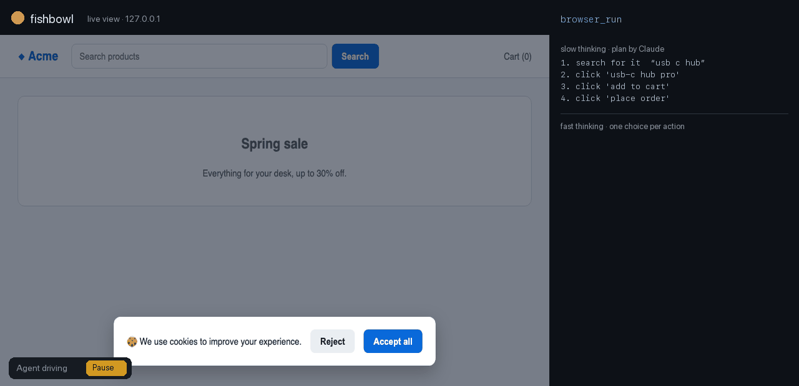
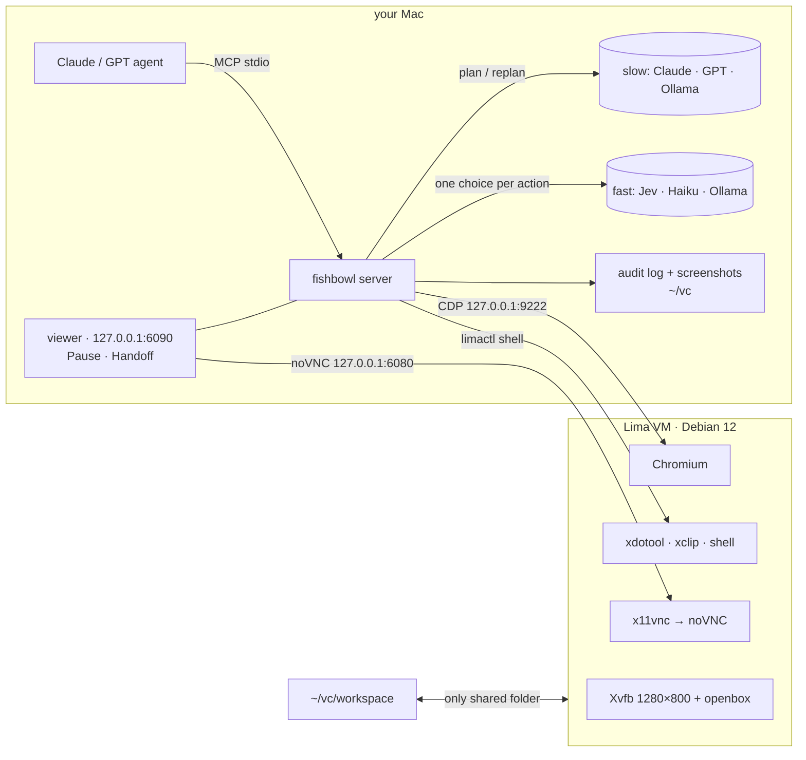

<div align="center">


# fishbowl

### Give your AI agent its own computer. Watch everything it does.

A sandboxed Linux desktop on your Mac that **Claude Code, Codex, Claude Desktop or Cursor** drives through **25 MCP tools**.<br>
You watch live in your browser, pause it with one click, and take over for logins and captchas.

[](https://github.com/ericwang915/fishbowl/actions/workflows/ci.yml)
[](LICENSE)


[](https://github.com/astral-sh/ruff)

[**Quick start**](#-quick-start) · [**Why**](#-why-fishbowl) · [**Features**](#-features) · [**Models**](#-bring-your-own-model-or-run-fully-local) · [**Clients**](docs/clients.md) · [**Tools**](docs/tools.md) · [**Security**](docs/security.md)



<sub>A real <code>browser_run</code> recording. <b>Slow thinking</b> writes a 4-step plan; <b>fast thinking</b> executes it with one choice per action,
<br>dismisses the cookie wall, and <b>stops before the irreversible "Place order" to ask you</b>. (<a href="scripts/make_demo.py">recorded</a> with the scripted test model)</sub>

</div>

---

## ⚡ Quick start

```bash
brew install lima
pip install git+https://github.com/ericwang915/fishbowl
fishbowl up        # creates the VM (first boot ~5 min)
fishbowl install   # registers with every MCP client it finds: Claude Code, Codex, Claude Desktop, Cursor
```

Then ask your agent:

> *Use fishbowl to open news.ycombinator.com and summarise the top 3 posts.*

A tab opens on your Mac showing the VM's screen, and you watch the agent work. Run `fishbowl doctor` if anything looks off.

| Client | One-liner | Notes |
|---|---|---|
| **Claude Code** | `fishbowl install --client claude-code` | check with `/mcp` |
| **Codex** | `fishbowl install --client codex` | sets `tool_timeout_sec = 900` and forwards your keys with `env_vars` |
| **Claude Desktop** | `fishbowl install --client claude-desktop` | restart the app |
| **Cursor** | `fishbowl install --client cursor` | |
| anything else | `fishbowl install --client print` | standard stdio JSON snippet |

See [docs/clients.md](docs/clients.md) for details, and [examples/AGENTS.md](examples/AGENTS.md) for house rules
to give your agent (Codex reads `AGENTS.md`; Claude Code reads `CLAUDE.md`).

## 🤔 Why fishbowl?

Computer-use agents are powerful and a little scary. Usually you choose between letting the agent loose on your
real machine and running a headless browser you can't see. fishbowl takes a third route:

| | Agent on your real Mac | Headless browser / Playwright MCP | **fishbowl** |
|---|:---:|:---:|:---:|
| Can't touch your files or accounts | ❌ | ✅ | ✅ VM sees only `~/vc/workspace` |
| You can watch it live | ✅ | ❌ | ✅ noVNC in your browser |
| Pause and take over mid-task | awkward | ❌ | ✅ one click, plus `handoff` |
| Full desktop, not just a browser | ✅ | ❌ | ✅ xdotool + shell |
| Asks before paying, sending or deleting | ❌ | ❌ | ✅ approval guard |
| Record of everything it did | ❌ | ❌ | ✅ JSONL audit log + screenshots |
| Long web tasks without big-model tokens | ❌ | ❌ | ✅ fast + slow thinking: Claude plans, Jev executes |

## ✨ Features

<table>
<tr><td width="50%" valign="top">

### 🔒 Isolated and local-first
- A Lima VM with Debian 12, a 1280×800 desktop, Chromium and a shell
- The only shared folder is `~/vc/workspace`
- Every port is bound to **127.0.0.1**, and every other guest port is ignored
- Every action goes to an append-only audit log, with secrets redacted
- Screenshots are kept for 7 days

</td><td width="50%" valign="top">

### 👀 Human in the loop
- The live viewer opens on the first action, and never opens a second copy
- **Pause / Resume** button in the corner of the viewer
- `handoff("log in please")` gives you the screen and waits until you click Done
- The clipboard syncs both ways between your Mac and the VM

</td></tr>
<tr><td valign="top">

### ⚡ Fast + slow thinking
**Slow**: Claude (or your agent) plans, and replans when the fast layer gets stuck.
**Fast**: [Jev](https://github.com/browser-use/jev-ultrafast), or any small model, executes:
- **One request per action** answers the operation *and* the target for each operation; every operation only offers compatible elements
- **One browser call per observation**, using visible text only
- A **freshness check** before every input, so it never acts on a stale decision
- **DONE has to be verified** independently
- **Typed text only comes from the plan**. Hands back after 3 actions that change nothing, a login wall, low confidence or a timeout
- [How it works →](docs/fast-slow.md)

</td><td valign="top">

### 🛡️ Approval guardrail
- Before every click or Enter, the guard asks: is this irreversible, or visible to other people?
- Paying, sending, deleting, submitting or publishing needs your OK, through MCP elicitation or a `needs_approval` result
- Card numbers (Luhn-checked) and API keys are **always** blocked from being typed
- If the model is unreachable, a keyword check in English, Chinese and Indonesian takes over, so the guard **fails closed**

</td></tr>
<tr><td valign="top">

### 💬 Built for chatbot QA
- `chat_ask` sends a question, confirms it appeared in the chat, and waits for the reply to settle. It ignores
  placeholders like *Thinking…* and *Sedang mengetik…*.
- It labels each outcome: `answered` · `no_reply` · `survey_only` · `placeholder_stuck` · `send_failed`
- `judge_reply` grades the reply type, language match, whether it is actionable, and whether it cites store data
- `model_stats` reports calls, tokens, latency and spend

</td><td valign="top">

### 🧰 Precise browser control
- Element tables with role, name, value, checked state and screen coordinates
- Text goes straight into the field after checking it is still there and **not covered**
- Detects modals and cookie walls, and finds the buttons that close them
- Waits for the page to settle, and manages tabs
- If fishbowl is updated while a session is running, results tell the client to reconnect

</td></tr>
</table>

## 🧠 Fast and slow thinking: bring your own models

| Role | Job | Providers (auto-detected from your keys) |
|---|---|---|
| **slow** | turns a goal into a plan, and replans after a handback | Anthropic `claude-sonnet-5-5` · OpenAI `gpt-4.1` · Ollama `qwen3:14b` |
| **fast** | answers multiple-choice questions: which operation, which element, is the step done, does this need approval, how good is this reply | **Jev** `jev-latest` · Anthropic `claude-haiku-5-5` · OpenAI `gpt-4.1-mini` · Ollama `qwen3:8b` |

When you drive fishbowl from Claude Code or Codex, **your agent already is the slow thinker**. Pass `plan`, and only
the fast role is used.

```bash
export TYPESAFE_API_KEY=…        # fast = Jev (TypeSafe), native multiple choice with calibrated probabilities
export ANTHROPIC_API_KEY=…       # slow = Claude (and fast, if no Jev key)
# or run everything locally:
export FISHBOWL_FAST=ollama FISHBOWL_SLOW=ollama FISHBOWL_SLOW_MODEL=qwen3:32b
# any OpenAI-compatible API (OpenRouter, Groq, DeepSeek, vLLM, LM Studio…):
export FISHBOWL_FAST=openai OPENAI_BASE_URL=https://openrouter.ai/api/v1 FISHBOWL_FAST_MODEL=…
export FISHBOWL_PRICE_IN=0.8 FISHBOWL_PRICE_OUT=4   # optional: USD per 1M tokens, so model_stats tracks spend
```

Jev answers multiple-choice questions natively. For Anthropic, OpenAI and Ollama, the same questions become an
enum-constrained JSON schema, so even a small local model can only pick an option that exists.

## 🧪 `browser_run`: three ways to call it

```jsonc
// 1. You are the slow thinker: pass a plan (Claude Code / Codex usually do this)
{"plan": [{"goal": "search for the product", "text": "usb c hub"}, {"goal": "open the first result"}, {"goal": "add it to the cart"}]}

// 2. Let fishbowl's slow model plan and replan
{"goal": "find a USB-C hub under $50 and add it to the cart"}

// 3. Both: start from your plan, and let the planner rescue it if it gets stuck
{"goal": "…", "plan": [ … ], "max_replans": 2}
```

The result is `done`, `handback`, `needs_approval`, `paused` or `timeout`. It comes with a reason, a per-step log
(operation, target, confidence), timing (observe, decide and act time; model and CDP calls), and on handback a
compact `observation` of the page, so the slow thinker can replan without another tool call. All **25 tools**
are documented in [docs/tools.md](docs/tools.md).

## 🏗️ Architecture



## ✅ Tested

```bash
pip install -e ".[dev]" && pytest     # real headless Chrome, no VM or API key needed
```

| Suite | What it covers |
|---|---|
| `browser_run`, 27 tasks across 9 types | search · forms · dropdowns · checkboxes and radios · cookie walls · scrolling and lazy loading · in-page tabs · slow pages · sites opening their own tabs |
| `browser_run` handback paths | no change ×3 · login wall · guard refusal · human approval · secret in plan · pause · low confidence · timeout · an answer outside the offered options (e.g. typing without prepared text) |
| Fast + slow thinking | goal-only planning · replanning after a handback · the planner asking for missing info · DONE rejected by verification · stale decisions re-decided · freshness check in the same round trip · one evaluate per observation |
| Providers | Jev `systemone` (multiple choice, retry on overload, invalid choices rejected) · enum-constrained emulation for Anthropic, OpenAI and Ollama · role resolution |
| Live desktop (CI) | Xvfb, openbox, Chrome, xdotool and xclip: screenshots, pixel clicks landing on elements, Unicode typing, clipboard round trip |
| Guard | fallback has 100% recall and 0% false blocks on 30 labelled actions plus a 10-action holdout; secret and card detection |
| MCP clients | a real stdio handshake (spawn `fishbowl mcp`, list 25 tools, call them) · `fishbowl install` for Codex, Claude Code, Claude Desktop and Cursor: merging, idempotency, removal |
| Plus | `chat_ask` outcomes · audit log · viewer and pause server · clipboard sync · VM isolation config · MCP SDK 1.x and 2.x |

CI uses a deterministic stand-in for both models. Run the same 27 tasks against **your** fast model with
`python examples/live_eval.py`.

**Speed.** On the 27-task suite (same scripted model, headless Chrome), the fast path cut browser round trips from
581 to 419 (−28%) and wall time from 45.5 s to about 35.6 s (−22%), compared with the first release. Model calls
stay at one per action, so with a real model the latency of that call dominates; that is where Jev's
one-round-trip decision pays off.

## 🖥️ CLI

```
fishbowl up | down | destroy --yes     VM lifecycle
fishbowl view                          open the live viewer
fishbowl doctor                        health checks (VM, CDP, noVNC, model)
fishbowl status | logs | stats         state, audit log, model usage
fishbowl install [--client X] [--remove]   register with Claude Code, Codex, Claude Desktop or Cursor
fishbowl mcp                           run the MCP server on stdio
```

## ❓ FAQ

<details><summary><b>Apple Silicon or Intel?</b></summary>
Apple Silicon is the main target. On Intel Macs, <code>fishbowl up</code> uses QEMU (<code>brew install qemu</code>), because
Apple's Virtualization.framework did not boot the VM in our testing. Intel support is not verified end to end yet.
</details>
<details><summary><b>Do logins persist?</b></summary>
Yes. The VM's Chromium profile keeps cookies, so you log in once through <code>handoff</code> and stay logged in.
</details>
<details><summary><b>Can the agent reach my files?</b></summary>
Only what you put in <code>~/vc/workspace</code>. See <a href="docs/security.md">the security model</a>.
</details>
<details><summary><b>Linux host?</b></summary>
Start the stack with <code>scripts/desktop-services.sh</code>, then run with <code>FISHBOWL_EXECUTOR=local</code>.
That is exactly what the CI desktop job does.
</details>

## 🗺️ Roadmap

- [ ] Verified Intel Mac support, and a prebuilt VM image for faster first boot
- [ ] Session recording (MP4) next to the audit log
- [ ] Egress allow-list for the VM
- [ ] Published benchmark of `browser_run` across local models

## 🙏 Credits

The fast execution path follows ideas from [browser-use/jev-ultrafast](https://github.com/browser-use/jev-ultrafast)
(MIT): the indexed per-operation action space, a single observation call, freshness checks before input, and
independent DONE verification.

## 🤝 Contributing

PRs are welcome, especially new `browser_run` task pages and guard or chat phrases in more languages. See [CONTRIBUTING.md](CONTRIBUTING.md).

If fishbowl saves you from an agent that went off the rails, consider giving it a ⭐. It helps others find it.

## License

[MIT](LICENSE)
