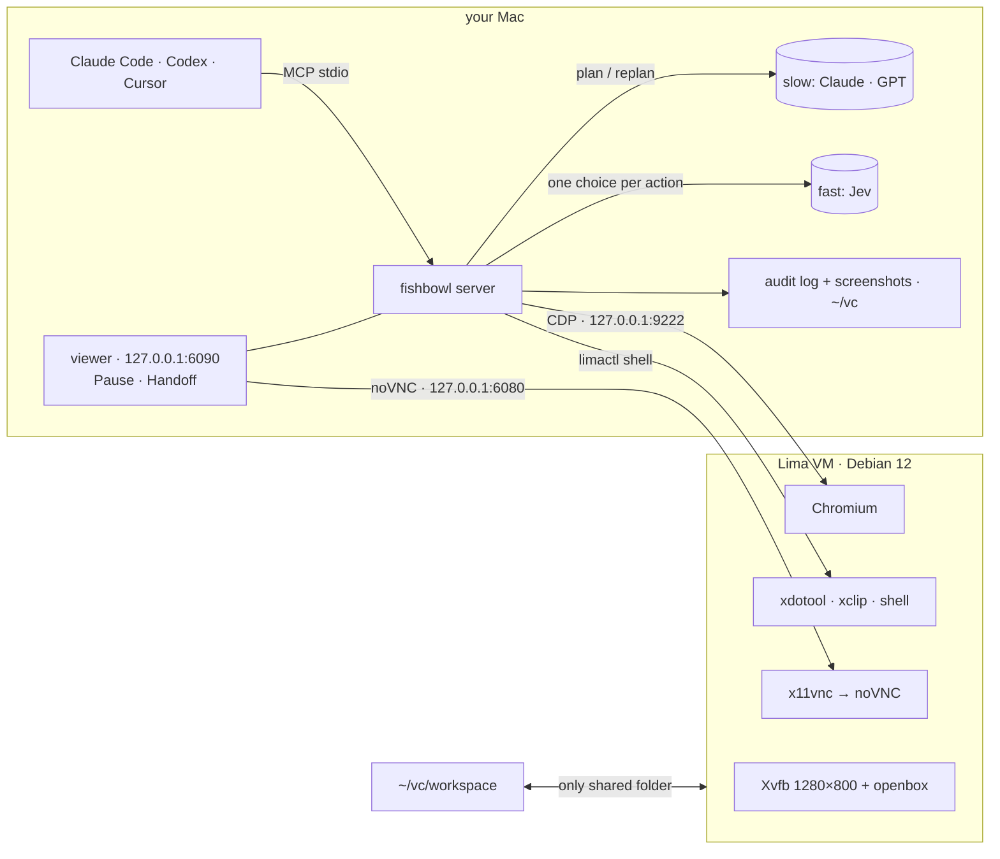

<div align="center">


# fishbowl-jev-ultrafast

### Claude plans. Jev clicks. You watch.

Give your AI agent its own Linux computer on your Mac, and see everything it does.<br>
**Claude Code, Codex, Claude Desktop or Cursor** drive it through **25 MCP tools**; you watch live, pause with one click,
<br>and take over for logins. An optional **fast mode** lets a big model plan while [Jev](https://github.com/browser-use/jev-ultrafast) executes each click.

[](https://github.com/ericwang915/fishbowl/actions/workflows/ci.yml)
[](https://github.com/ericwang915/fishbowl/releases)
[](LICENSE)


[**Quick start**](#-quick-start) · [**Why**](#-why-fishbowl) · [**Fast mode**](#-claude-plans-jev-executes) · [**Features**](#-features) · [**Clients**](#-use-it-from-your-agent) · [**FAQ**](#-faq) · [**Docs**](docs/)


<sub>A real <code>browser_run</code> recording. The plan comes from slow thinking; fast thinking makes one choice per action, dismisses the cookie
<br>wall, and <b>stops before the irreversible "Place order" to ask you</b>. (<a href="scripts/make_demo.py">Recorded</a> with the scripted test model.)</sub>

</div>

---

## ⚡ Quick start

```bash
brew install lima
pip install git+https://github.com/ericwang915/fishbowl
fishbowl up        # creates the VM (first boot ~5 min)
fishbowl install   # registers with Claude Code, Codex, Claude Desktop and Cursor, whichever you have
```

Then ask your agent:

> *Use fishbowl to open news.ycombinator.com and summarise the top 3 posts.*

A tab opens on your Mac with the VM's screen, and you watch the agent work. **No API key is needed.** Add
`TYPESAFE_API_KEY` later to turn on [fast mode](#-claude-plans-jev-executes). `fishbowl doctor` checks everything.

## 🤔 Why fishbowl?

Computer-use agents are powerful and a little scary. Usually you choose between letting the agent loose on your
real machine and running a headless browser you can't see. fishbowl takes a third route:

| | Agent on your real Mac | Headless browser / Playwright MCP | **fishbowl** |
|---|:---:|:---:|:---:|
| Can't touch your files or accounts | ❌ | ✅ | ✅ VM sees only `~/vc/workspace` |
| You can watch it live | ✅ | ❌ | ✅ noVNC in your browser |
| Pause and take over mid-task | awkward | ❌ | ✅ one click, plus `handoff` |
| Full desktop, not just a browser | ✅ | ❌ | ✅ xdotool + shell |
| Asks before paying, sending or deleting | ❌ | ❌ | ✅ approval guard |
| Record of everything it did | ❌ | ❌ | ✅ JSONL audit log + screenshots |
| Long web tasks without big-model tokens | ❌ | ❌ | ✅ fast mode: Claude plans, Jev executes |

## 🧠 Claude plans, Jev executes

Big models are good at deciding *what* to do and slow at clicking through a page. fishbowl splits the work:

```
 slow thinking  ─ Claude / GPT / your agent ─────────────────────────────────────────────
   goal ─► plan: [{goal: "search for it", text: "usb c hub"}, {goal: "open the first result"}, …]
                                  │                                     ▲
                                  ▼                                     │ handback + page observation
 fast thinking  ─ Jev ───────────────────────────────────────────────────────────────────
   per action, ONE request:  operation?  click_target?  type_target?  select_target?
   → freshness check → act → "is this step done?" → next step
```

- **One request per action.** Jev answers the operation *and* a target for each operation in one round trip.
  Each operation only offers compatible elements, and dropdown options are chosen directly.
- **One browser call per observation**, using visible text only. Every input is preceded by a **freshness check**,
  in the same round trip as the hit test, so a stale decision is never executed.
- **The fast model never writes text.** Every string it types was written into the plan by the slow thinker.
- **`DONE` must be verified** by a separate question. Stuck, unsure or blocked? It hands back with a compact page
  observation, and the slow model replans from there.

| You set | What works |
|---|---|
| nothing | Everything except `browser_run`: your agent drives with the `browser_*` tools step by step, and the guard uses keyword rules |
| `TYPESAFE_API_KEY` | **Fast mode**: `browser_run(plan=…)` runs on Jev, and so do the guard and `judge_reply` |
| + `ANTHROPIC_API_KEY` or `OPENAI_API_KEY` | `browser_run(goal=…)`: fishbowl plans and replans by itself (Claude Sonnet / GPT-4.1) |

When Claude Code or Codex drive fishbowl, **they already are the slow thinker**: they pass a `plan`, and only Jev
is needed.

```jsonc
// you plan (what Claude Code and Codex do)
{"plan": [{"goal": "search for the product", "text": "usb c hub"}, {"goal": "open the first result"}]}
// fishbowl plans, and replans when stuck
{"goal": "find a USB-C hub under $50 and add it to the cart"}
// both: start from your plan, and let the planner rescue it
{"goal": "…", "plan": [ … ], "max_replans": 2}
```

Results are `done`, `handback`, `needs_approval`, `paused` or `timeout`, with a reason, a per-step log (operation,
target, confidence) and timing. **[How it works →](docs/fast-slow.md)**

<details><summary><b>Use a different fast model, or run fully local</b></summary>

Fast mode turns on automatically only with Jev. Other models can be chosen explicitly. The same multiple-choice
questions become an enum-constrained JSON schema, so the model can only pick options that exist.

```bash
export FISHBOWL_FAST=ollama FISHBOWL_FAST_MODEL=qwen3:8b       # local fast model
export FISHBOWL_SLOW=ollama FISHBOWL_SLOW_MODEL=qwen3:32b      # local planner
export FISHBOWL_FAST=openai OPENAI_BASE_URL=https://openrouter.ai/api/v1 FISHBOWL_FAST_MODEL=…   # OpenAI-compatible
export FISHBOWL_PRICE_IN=0.8 FISHBOWL_PRICE_OUT=4              # USD per 1M tokens, so model_stats tracks spend
```
</details>

## ✨ Features

<table>
<tr><td width="50%" valign="top">

### 🔒 Isolated and local-first
- Lima VM: Debian 12, a 1280×800 desktop, Chromium and a shell
- The only shared folder is `~/vc/workspace`
- Ports are bound to **127.0.0.1**, and every other guest port is ignored
- Append-only audit log of every action, with secrets redacted
- Screenshots are kept for 7 days

</td><td width="50%" valign="top">

### 👀 Human in the loop
- The live viewer opens on the first action, never twice
- **Pause / Resume** in the corner of the viewer
- `handoff("please log in")`: you get the screen, and the agent waits until you click **Done**
- The clipboard bridge never touches disk. Your Mac clipboard enters the VM only while *you* have the screen,
  and is wiped when you hand it back

</td></tr>
<tr><td valign="top">

### 🛡️ Approval guard
- Before every click or Enter, the guard asks whether the action is irreversible, or visible to others
- Paying, sending, deleting, submitting or publishing needs your OK, through MCP elicitation or `needs_approval`
- Card numbers (Luhn-checked) and API keys are **never** typed
- Without fast mode, or if the model is down, multilingual keyword rules take over: it **fails closed**

</td><td valign="top">

### 🧰 Precise browser control
- Element tables with role, name, value, checked state and screen coordinates
- Text goes straight into the field, after checking it is still there and **not covered**
- Finds modals and cookie walls, and the buttons that close them
- Waits for the page to settle; tabs a site opens never steal the working tab
- Unicode typing in the desktop too (é, 中文, emoji)

</td></tr>
<tr><td valign="top">

### 💬 Chatbot QA
- `chat_ask` sends a question, confirms it was posted, and waits for the reply to settle, ignoring *Thinking…* or
  *Sedang mengetik…*
- Labels each outcome: `answered` · `no_reply` · `survey_only` · `placeholder_stuck` · `send_failed`
- `judge_reply` grades the reply type, language match, whether it is actionable, and whether it cites store data, with a 1–5 score
- `model_stats`: calls, tokens, latency and spend

</td><td valign="top">

### 🔁 Built to live with
- Works with MCP SDK 1.x and 2.x, on Python 3.10+
- Progress notifications keep long runs alive in clients with per-call timeouts
- Tells the client to reconnect when fishbowl is upgraded under a running session
- `fishbowl doctor`: VM, CDP, noVNC, and which thinking modes are on
- [All 25 tools →](docs/tools.md)

</td></tr>
</table>

## 🔌 Use it from your agent

`fishbowl install` finds your MCP clients and registers fishbowl with each of them. To target one client, run
`fishbowl install --client <name>`. It never writes API keys to config files.

| Client | `--client` | Notes |
|---|---|---|
| **Claude Code** | `claude-code` | user scope; check with `/mcp` |
| **Codex** | `codex` | sets `tool_timeout_sec = 900`, and forwards your keys via `env_vars` |
| **Claude Desktop** | `claude-desktop` | restart the app afterwards |
| **Cursor** | `cursor` | |
| anything else | `print` | prints a standard stdio JSON snippet |

Give your agent the house rules in [examples/AGENTS.md](examples/AGENTS.md): Codex reads `AGENTS.md`, and Claude Code
reads `CLAUDE.md`. Details are in [docs/clients.md](docs/clients.md).

## 🧱 Architecture



The security model, including what fishbowl does *not* protect against, is in [docs/security.md](docs/security.md).

## ✅ Tested

**138 tests on real headless Chrome**, plus **7 on a live X desktop** in CI, across Python 3.10 and 3.12 and MCP SDK 1.x and 2.x.
No VM or API key is needed to run them:

```bash
pip install -e ".[dev]" && pytest
```

<details><summary><b>What the suites cover</b></summary>

| Suite | Covers |
|---|---|
| `browser_run`: 27 tasks across 9 types | search · forms · dropdowns · checkboxes and radios · cookie walls · scrolling and lazy loading · in-page tabs · slow pages · sites opening their own tabs |
| Handback paths | no change ×3 · login wall · guard refusal · human approval · secret in plan · pause · low confidence · timeout · an answer outside the offered options |
| Fast + slow thinking | goal-only planning · replanning · the planner asking for missing info · `DONE` rejected by verification · stale decisions re-decided · fast mode off without Jev |
| Providers | Jev `systemone` (multiple choice, retry on overload, invalid choices rejected) · enum-constrained Anthropic, OpenAI and Ollama |
| Live desktop (CI) | screenshots · pixel clicks landing on elements · Unicode typing · the clipboard bridge with real xclip |
| Guard | keyword fallback: 100% recall and 0% false blocks on 30 labelled actions plus a 10-action holdout · secret and card detection |
| MCP clients | a real stdio handshake (spawn, list 25 tools, call them) · `fishbowl install` merging, idempotency and removal for all four clients |
</details>

CI replaces both models with a deterministic stand-in. To measure **your** fast model on the same 27 tasks, run
`python examples/live_eval.py`.

**Speed of the fast path** (27-task suite, same scripted model, so only the engine differs):

| | v0.1.0 | now |
|---|---:|---:|
| browser round trips | 581 | **419** (−28%) |
| wall time | 45.5 s | **≈35.6 s** (−22%) |

With a real model, the model call dominates each action, and that is the round trip Jev keeps to one.

## 🖥️ CLI

```
fishbowl up | down | destroy --yes          VM lifecycle
fishbowl view                               open the live viewer
fishbowl doctor                             health checks, and which thinking modes are on
fishbowl status | logs | stats              state, audit log, model usage and spend
fishbowl install [--client X] [--remove]    register with Claude Code, Codex, Claude Desktop or Cursor
fishbowl mcp                                run the MCP server on stdio
```

## ❓ FAQ

<details><summary><b>Do I need an API key?</b></summary>

No. Without keys, your agent drives the VM with the step-by-step tools, and the guard uses keyword rules. A Jev key
(`TYPESAFE_API_KEY`) turns on fast mode. An Anthropic or OpenAI key additionally lets `browser_run` plan from a goal.
</details>

<details><summary><b>What is Jev?</b></summary>

A structured decision model from TypeSafe. It answers multiple-choice questions with calibrated probabilities, which
makes it a natural fit for "which operation, on which element?". See
[browser-use/jev-ultrafast](https://github.com/browser-use/jev-ultrafast).
</details>

<details><summary><b>Can it log into Gmail, X, and other sites?</b></summary>

Through `handoff`: you type the credentials in the live view yourself, so the agent never sees them, and the session
persists in the VM's Chromium profile. Google sometimes refuses sign-in from browsers it considers automated. That
is outside fishbowl's control. Use dedicated accounts for agent work.
</details>

<details><summary><b>Can the agent reach my files?</b></summary>

Only what you put in `~/vc/workspace`. See [the security model](docs/security.md).
</details>

<details><summary><b>Apple Silicon or Intel?</b></summary>

Apple Silicon is the main target. On Intel Macs, `fishbowl up` uses QEMU (`brew install qemu`), because Apple's
Virtualization.framework did not boot the VM in our testing.
</details>

<details><summary><b>Linux host?</b></summary>

Start the desktop stack with `scripts/desktop-services.sh`, then run with `FISHBOWL_EXECUTOR=local`. The CI desktop
job does exactly this.
</details>

## 🗺️ Status and roadmap

**v0.1, early.** The tools, `browser_run` and the desktop stack are tested in CI. The Lima VM template itself has
not yet been verified end to end on a Mac, and live runs against Jev are pending. Reports from your machine are very
welcome.

- [ ] Verified first boot on Apple Silicon and Intel, and a prebuilt image for faster setup
- [ ] Published `browser_run` benchmark on Jev and local models
- [ ] Session recording (MP4) next to the audit log
- [ ] Egress allow-list for the VM

## 🙏 Credits

The fast path adapts ideas from [browser-use/jev-ultrafast](https://github.com/browser-use/jev-ultrafast) (MIT): the
indexed per-operation action space, the single observation call, freshness checks before input, and independent
`DONE` verification. The live view is [noVNC](https://github.com/novnc/noVNC), and the VM is [Lima](https://github.com/lima-vm/lima).

## 🤝 Contributing

PRs are welcome, especially new `browser_run` task pages, and guard or chat phrases in more languages. See
[CONTRIBUTING.md](CONTRIBUTING.md).

If fishbowl keeps an agent from going off the rails for you, a ⭐ helps others find it.

## License

[MIT](LICENSE)
