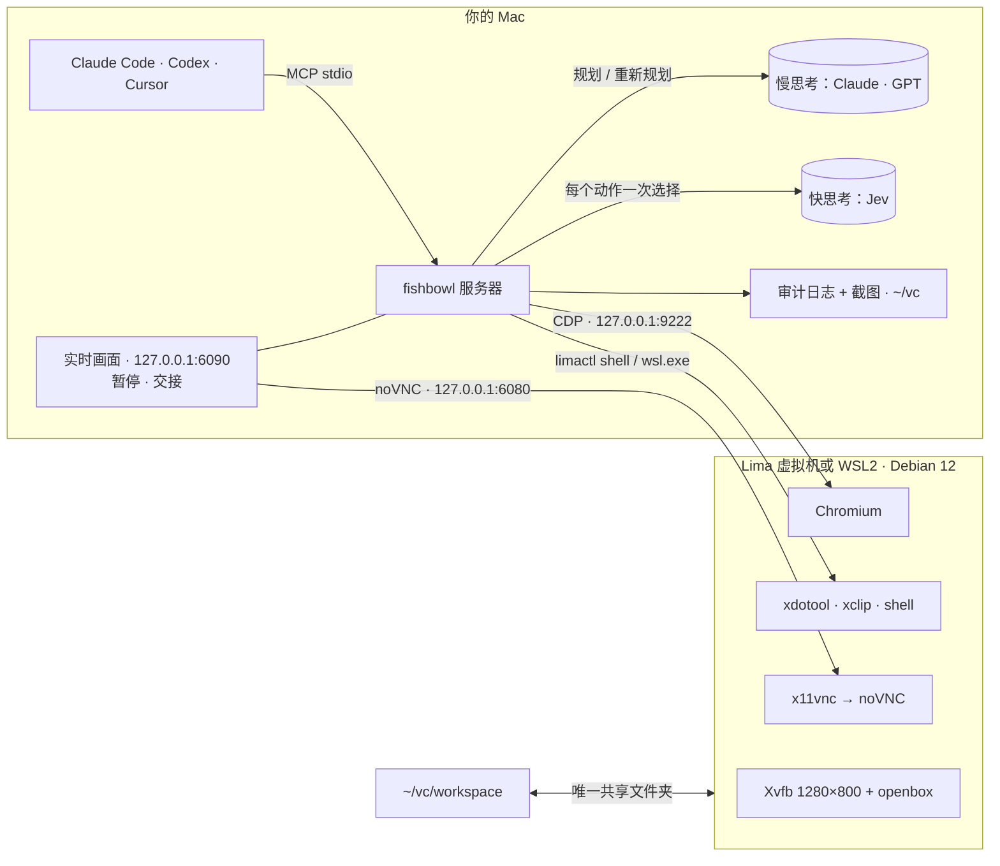

<a id="readme-top"></a>

<div align="center">

<picture>
  <source media="(prefers-color-scheme: dark)" srcset="docs/banner-dark.svg">
  
</picture>

# fishbowl-jev-ultrafast

**给你的 AI 智能体一台自己的电脑，它做的每一步你都看得见。**

一台跑在你 Mac 或 Windows 电脑上的隔离 Linux 桌面，Claude Code、Codex、Claude Desktop 或 Cursor 通过 25 个 MCP 工具来操作它。
<br>你可以实时观看、一键暂停、遇到登录时接管。可选的**快速模式**：Claude 负责规划，[Jev](https://github.com/browser-use/jev-ultrafast) 负责执行每一次点击。

[English](README.md) · **简体中文**

[](https://github.com/ericwang915/fishbowl/actions/workflows/ci.yml)
[](https://github.com/ericwang915/fishbowl/releases)
[](LICENSE)


[](https://github.com/ericwang915/fishbowl/stargazers)

[](docs/)
[](docs/tools.md)
[](docs/fast-slow.md)
[](docs/security.md)
[](https://github.com/ericwang915/fishbowl/discussions)

<br>


<sub>一段真实的 <code>browser_run</code> 录屏：快思考每个动作只做一次选择，先关掉 cookie 弹窗，
<b>在不可逆的“下单”之前停下来问你</b>。（用测试用的固定规则模型<a href="scripts/make_demo.py">录制</a>。）</sub>

</div>

<br>

> [!NOTE]
> **v0.1，早期版本。** CI 中会用 `fishbowl up` 真实启动虚拟机（Linux 上的 Lima + KVM），并在上面跑通实机测试：截图、
> 像素点击、Unicode 输入、剪贴板、隔离检查、`browser_run`。测试集也在 macOS（Apple Silicon 和 Intel）和 Windows 上运行。
> 尚未验证：在实体 Mac 上启动虚拟机、Windows 上的 WSL，以及真实的 Jev 调用。非常欢迎[反馈你机器上的运行情况](https://github.com/ericwang915/fishbowl/issues/new/choose)。

<details>
<summary><b>目录</b></summary>

- [快速上手](#-快速上手)
- [支持的平台](#-支持的平台)
- [能用它做什么？](#-能用它做什么)
- [为什么选 fishbowl？](#-为什么选-fishbowl)
- [快速模式：Claude 规划，Jev 执行](#-快速模式claude-规划jev-执行)
- [功能](#-功能)
- [接入你的智能体](#-接入你的智能体)
- [架构](#-架构)
- [配置](#-配置)
- [测试](#-测试)
- [常见问题](#-常见问题)
- [路线图](#-路线图)
</details>

## 🚀 快速上手

**1. 安装虚拟机运行环境**，再安装 fishbowl

| macOS（Apple Silicon 或 Intel） | Windows 10/11（x64 或 ARM） | Linux |
|---|---|---|
| `brew install lima`<br>Intel Mac 另需：`brew install qemu` | 不用装：`fishbowl up` 会自动安装或升级 WSL<br>（第一次需要点一次管理员授权，然后重启） | [Lima](https://lima-vm.io/docs/installation/) + QEMU/KVM |

```bash
pip install git+https://github.com/ericwang915/fishbowl
```

**2. 创建虚拟机。** 第一次启动会下载 Debian 并安装桌面，大约需要 5 分钟。

```bash
fishbowl up
```

**3. 接入你的智能体。** 自动找到本机的 Claude Code、Codex、Claude Desktop 和 Cursor，并逐个注册。

```bash
fishbowl install
```

**4. 检查一下，然后开始用。**

```console
$ fishbowl doctor
fishbowl 0.1.0
  ✓ limactl installed
  ✓ VM 'fishbowl' running
  ✓ Chromium CDP on http://127.0.0.1:9222
  ✓ noVNC on 127.0.0.1:6080
  ✓ workspace /Users/you/vc/workspace
  · fast thinking: off — set TYPESAFE_API_KEY to execute with Jev (or FISHBOWL_FAST=anthropic|openai|ollama)
  · slow thinking: off — set ANTHROPIC_API_KEY or OPENAI_API_KEY (or FISHBOWL_SLOW=ollama)
All good.
```

> *用 fishbowl 打开 news.ycombinator.com，总结排名前三的帖子。*

浏览器里会弹出一个标签页，显示虚拟机的屏幕，你可以看着智能体干活。**不需要任何 API key。** 想开启
[快速模式](#-快速模式claude-规划jev-执行)，设置 `export TYPESAFE_API_KEY=…` 后重新连接 MCP 服务器即可。

## 💻 支持的平台

所有平台跑的是同一套桌面（Debian 12、Xvfb 1280×800、Chromium、noVNC），由同一份脚本配置：

| 宿主机 | 虚拟机 | 隔离 | 验证情况 |
|---|---|---|---|
| **macOS · Apple Silicon** | Lima + Apple 虚拟化框架（`vz`、virtiofs） | 只挂载 `~/vc/workspace`；端口只绑 127.0.0.1 | CI 跑测试集；尚未验证虚拟机启动 |
| **macOS · Intel** | Lima + QEMU | 同上 | CI 跑测试集；尚未验证虚拟机启动 |
| **Windows 10/11 · x64（Intel / AMD）或 ARM** | 开启 systemd 的 WSL2 发行版 | 不挂载 Windows 磁盘（只通过 fstab 挂工作区）、禁止调用 Windows 程序、非特权用户 | CI 跑测试集（x64）；尚未验证 WSL 启动 |
| **Linux · x86_64 / arm64** | Lima + QEMU/KVM（sshfs 挂载） | 同 macOS | ✅ **CI 中真实启动虚拟机并通过实机测试** |

`fishbowl doctor` 会显示识别到的宿主机和所用后端。

## 💡 能用它做什么？

fishbowl 接好后，把下面任意一句发给 Claude Code 或 Codex：

| | 试着这样说 | 会发生什么 |
|---|---|---|
| 🔎 | *“打开 Linear、Height 和 Jira 的定价页，在 /workspace/pricing.md 里做一张对比表。”* | 智能体在虚拟机里浏览网页，文件出现在你 Mac 的 `~/vc/workspace` 里 |
| 🔐 | *“打开 x.com，如果我没登录就把屏幕交给我，然后把我最近 20 条书签存到 /workspace/bookmarks.csv。”* | `handoff` 把屏幕交给你登录，登录状态会保留到下次 |
| 📝 | *“用 /workspace/vendor.json 里的信息填写 ‹网址› 上的供应商表单，但不要提交。”* | 字段直接写进页面；任何提交动作都会被护栏拦下，等你批准 |
| 💬 | *“把 /workspace/questions.txt 里的每个问题发给 ‹商店› 的客服机器人，给每条回复打分，结果写进 results.csv。”* | `chat_ask` 和 `judge_reply` 给每条回复打标签：没回复、只弹满意度评价、语言不对、没法照着做…… |
| ⚡ | *“用 browser_run，目标是：在 ‹商店› 找一个 50 美元以下的 USB-C 扩展坞并加入购物车。”* | 快速模式：Claude 规划、Jev 执行，在结账前停下 |
| 🖥️ | *“在虚拟机里装上 ffmpeg，把 /workspace/clip.mov 转成 GIF。”* | `shell` 在虚拟机里运行，永远不碰你的 Mac |

> [!TIP]
> 把 [`examples/AGENTS.md`](examples/AGENTS.md) 放进你的项目（Codex 读 `AGENTS.md`；Claude Code 请复制到 `CLAUDE.md`）。
> 它会教智能体几条规矩：优先用 `browser_*` 而不是按像素点击、用 `browser_run` 做计划、登录时用 `handoff`、永远不要绕过护栏。

## 🤔 为什么选 fishbowl？

能操作电脑的智能体很强大，也有点吓人。通常你只能二选一：要么让智能体直接在你的真机上乱跑，要么用一个你看不见的无头浏览器。
fishbowl 走第三条路：

| | 智能体直接用你的 Mac | 无头浏览器 / Playwright MCP | **fishbowl** |
|---|:---:|:---:|:---:|
| 碰不到你的文件和账号 | ❌ | ✅ | ✅ 虚拟机只能看到 `~/vc/workspace` |
| 能实时观看 | ✅ | ❌ | ✅ 浏览器里的 noVNC 画面 |
| 随时暂停、中途接管 | 很别扭 | ❌ | ✅ 一键暂停，还有 `handoff` |
| 完整桌面，不只是浏览器 | ✅ | ❌ | ✅ xdotool + shell |
| 付款、发送、删除前先问你 | ❌ | ❌ | ✅ 审批护栏 |
| 记录它做过的每件事 | ❌ | ❌ | ✅ JSONL 审计日志 + 截图 |
| 长网页任务不烧大模型 token | ❌ | ❌ | ✅ 快速模式：Claude 规划，Jev 执行 |

## ⚡ 快速模式：Claude 规划，Jev 执行

大模型擅长决定*做什么*，但一页一页点下去很慢。fishbowl 把活拆开：

```
 慢思考   Claude / GPT / 你的智能体
   目标 ─► 计划：[{goal: "search for it", text: "usb c hub"}, {goal: "open the first result"}, …]
                                  │                                     ▲
                                  ▼                                     │  交还 + 页面摘要
 快思考   Jev
   每个动作只发一次请求：  做什么操作？ 点哪个？ 往哪输入？ 选哪个选项？
   → 新鲜度检查 → 执行 → “这一步完成了吗？” → 下一步
```

| | 含义 |
|---|---|
| **每个动作一次请求** | Jev 在一次往返里同时回答“做什么操作”和每种操作“选哪个元素”。每种操作只列出兼容的元素，下拉框直接选到具体选项 |
| **每次观察一次浏览器调用** | 元素表、可见文字、弹窗和页面指纹，一次 `Runtime.evaluate` 全部读完 |
| **过期就不执行** | 新鲜度检查和点击前的定位在同一次往返里完成，所以永远不会执行过期的决策 |
| **快模型从不写文字** | 它输入的每一个字，都是慢思考事先写进计划的 |
| **`DONE` 要经过验证** | 另发一个问题核实“完成了”的说法。卡住、拿不准或被挡住时，会带着页面摘要交还，由慢思考重新规划 |

| 你配置了 | 能用什么 |
|---|---|
| 什么都没配 | 除 `browser_run` 外全部可用：智能体用 `browser_*` 工具一步步操作，护栏用关键词规则 |
| `TYPESAFE_API_KEY` | **快速模式**：`browser_run(plan=…)` 用 Jev 执行，护栏和 `judge_reply` 也走 Jev |
| 再加 `ANTHROPIC_API_KEY` 或 `OPENAI_API_KEY` | `browser_run(goal=…)`：fishbowl 自己规划、自己重新规划（Claude Sonnet / GPT-4.1） |

由 Claude Code 或 Codex 驱动时，**它们自己就是慢思考**：它们直接传 `plan`，只需要 Jev。

```jsonc
// 你来规划（Claude Code 和 Codex 就是这么用的）
{"plan": [{"goal": "search for the product", "text": "usb c hub"}, {"goal": "open the first result"}]}
// fishbowl 来规划，卡住时重新规划
{"goal": "find a USB-C hub under $50 and add it to the cart"}
// 两者都给：先按你的计划，卡住了由规划模型接手
{"goal": "…", "plan": [ … ], "max_replans": 2}
```

结果是 `done`、`handback`、`needs_approval`、`paused` 或 `timeout`，附带原因、逐步日志（操作、目标、置信度）和耗时。
**[阅读设计文档 →](docs/fast-slow.md)**

<details><summary><b>换一个快速模型，或者完全本地运行</b></summary>

只有配了 Jev 时快速模式才会自动开启。其他模型可以手动指定，同一套多选题会变成带枚举约束的 JSON schema，模型只能从存在的选项里选。

```bash
export FISHBOWL_FAST=ollama FISHBOWL_FAST_MODEL=qwen3:8b       # 本地快速模型
export FISHBOWL_SLOW=ollama FISHBOWL_SLOW_MODEL=qwen3:32b      # 本地规划模型
export FISHBOWL_FAST=openai OPENAI_BASE_URL=https://openrouter.ai/api/v1 FISHBOWL_FAST_MODEL=…   # 任何 OpenAI 兼容接口
```
</details>

## ✨ 功能

<table>
<tr><td width="50%" valign="top">

### 🔒 隔离、本地优先
- Lima 虚拟机（macOS、Linux）或 WSL2（Windows）：Debian 12、1280×800 桌面、Chromium 和 shell
- 唯一共享的文件夹是 `~/vc/workspace`；在 Windows 上，磁盘挂载和调用 Windows 程序都被关闭
- 端口只绑定 **127.0.0.1**，其他端口一律不转发
- 每个动作都写进只追加的审计日志，敏感信息自动遮蔽
- 截图保留 7 天

</td><td width="50%" valign="top">

### 👀 人始终在场
- 第一次操作时自动打开实时画面，已经开着就不重复打开
- 画面角落有 **暂停 / 继续** 按钮
- `handoff("请登录")`：屏幕交给你，智能体等你点 **Done**
- 剪贴板从不落盘。你 Mac 上的剪贴板只在*你*掌控屏幕时才进入虚拟机，交还时自动清空

</td></tr>
<tr><td valign="top">

### 🛡️ 审批护栏
- 每次点击或回车前，先判断这个动作是否不可逆、是否对别人可见
- 付款、发送、删除、提交、发布需要你同意，通过 MCP elicitation 或 `needs_approval` 询问
- 卡号（Luhn 校验）和 API key **永远不会**被输入
- 没开快速模式或模型连不上时，改用多语言关键词规则：宁可多拦，**不会放过**

</td><td valign="top">

### 🧰 精确的浏览器控制
- 元素表包含角色、名称、当前值、勾选状态和屏幕坐标
- 文字直接写进输入框，写之前确认元素还在、**没被遮住**
- 识别弹窗和 cookie 墙，并找到关闭按钮
- 等页面稳定再操作；网站自己弹出的标签页不会把操作带跑
- 桌面上也能输入 Unicode（é、中文、emoji）

</td></tr>
<tr><td valign="top">

### 💬 聊天机器人测试
- `chat_ask` 发问、确认消息真的发出去了、等回复稳定，忽略 *Thinking…*、*Sedang mengetik…* 这类占位文字
- 给结果打标签：`answered` · `no_reply` · `survey_only` · `placeholder_stuck` · `send_failed`
- `judge_reply` 判断回复类型、语言是否一致、能否照着做、是否引用店铺数据，并给 1–5 分
- `model_stats`：调用次数、token、延迟和花费

</td><td valign="top">

### 🔁 好用、耐用
- 支持 MCP SDK 1.x 和 2.x，Python 3.10+
- 进度通知让有超时限制的客户端也能等完长任务
- fishbowl 升级后，正在运行的会话会提示客户端重新连接
- `fishbowl doctor`：检查虚拟机、CDP、noVNC，以及开启了哪些思考模式
- [全部 25 个工具 →](docs/tools.md)

</td></tr>
</table>

<p align="right"><a href="#readme-top">回到顶部 ↑</a></p>

## 🔌 接入你的智能体

`fishbowl install` 会找到你的 MCP 客户端并逐个注册。只想注册某一个，运行 `fishbowl install --client <名字>`。
它从不把 API key 写进配置文件。

| 客户端 | `--client` | 说明 |
|---|---|---|
| **Claude Code** | `claude-code` | 用户级配置；用 `/mcp` 检查 |
| **Codex** | `codex` | 设置 `tool_timeout_sec = 900`，并通过 `env_vars` 转发你的 key |
| **Claude Desktop** | `claude-desktop` | 之后重启应用 |
| **Cursor** | `cursor` | |
| 其他客户端 | `print` | 打印一段标准的 stdio JSON 配置 |

<details><summary><b>手动配置（任何 MCP 客户端）</b></summary>

```json
{
  "mcpServers": {
    "fishbowl": { "command": "fishbowl", "args": ["mcp"] }
  }
}
```

如果你的客户端启动服务器时 PATH 很精简，请把 `command` 换成 `which fishbowl` 给出的绝对路径。各客户端的详细说明见
[docs/clients.md](docs/clients.md)。
</details>

## 🧱 架构



安全模型（包括 fishbowl *不*防什么）见 [docs/security.md](docs/security.md)。

## 🔧 配置

默认配置就能用。需要调整时设置这些环境变量：

| 变量 | 默认值 | 作用 |
|---|---|---|
| `TYPESAFE_API_KEY` | — | 开启 Jev 快速模式 |
| `ANTHROPIC_API_KEY` / `OPENAI_API_KEY` | — | 开启 `browser_run(goal=…)` 的规划模型 |
| `FISHBOWL_FAST`、`FISHBOWL_FAST_MODEL` | `jev`、`jev-latest` | 快速模型：`jev`、`anthropic`、`openai` 或 `ollama` |
| `FISHBOWL_SLOW`、`FISHBOWL_SLOW_MODEL` | 根据你的 key | 规划模型：`anthropic`、`openai` 或 `ollama` |
| `FISHBOWL_LLM_BASE_URL` | 各家默认 | 自定义接口地址（OpenRouter、vLLM、LM Studio……） |
| `FISHBOWL_PRICE_IN` / `FISHBOWL_PRICE_OUT` | — | 每百万 token 的美元价格，让 `model_stats` 统计花费 |
| `FISHBOWL_GUARD` | `model` | `model`、`heuristic`（只用关键词规则）或 `off` |
| `FISHBOWL_HOME` | `~/vc` | 工作区、审计日志、截图和状态文件的位置 |
| `FISHBOWL_SCREENSHOT_DAYS` | `7` | 截图保留天数 |
| `FISHBOWL_AUTO_OPEN` | `1` | 第一次操作时自动打开实时画面 |
| `FISHBOWL_VM` | `fishbowl` | Lima 实例名 / WSL 发行版名 |
| `FISHBOWL_VM_TYPE` | `vz`（Apple Silicon）、`qemu`（Intel、Linux） | 强制指定 Lima 虚拟机类型 |
| `FISHBOWL_MOUNT_TYPE` | `virtiofs`（vz）、`reverse-sshfs`（QEMU） | 强制指定 Lima 挂载方式 |
| `FISHBOWL_CDP_PORT` / `FISHBOWL_NOVNC_PORT` / `FISHBOWL_CONTROL_PORT` | `9222` / `6080` / `6090` | 本地端口，全部在 127.0.0.1 |
| `FISHBOWL_EXECUTOR` | `lima`（macOS、Linux）、`wsl`（Windows） | 设为 `local` 时在本机执行命令（CI） |

<details><summary><b>命令行参考</b></summary>

```
fishbowl up | down | destroy --yes          创建/启动、停止、删除虚拟机
fishbowl view                               打开实时画面
fishbowl doctor                             健康检查，以及开启了哪些思考模式
fishbowl status | logs | stats              状态、审计日志、模型用量和花费
fishbowl install [--client X] [--remove]    注册到 Claude Code、Codex、Claude Desktop 或 Cursor
fishbowl mcp                                以 stdio 方式运行 MCP 服务器
```
</details>

## ✅ 测试

**170 多个测试跑在真实的无头 Chrome 上**，覆盖 Linux、macOS（Apple Silicon 和 Intel）和 Windows，以及 Python 3.10/3.12、
MCP SDK 1.x/2.x。CI 还会运行真实的 X 桌面，并用 `fishbowl up` **真实启动虚拟机**进行测试。跑测试集不需要虚拟机，也不需要 API key：

```bash
pip install -e ".[dev]" && pytest
```

<details><summary><b>各测试覆盖的内容</b></summary>

| 测试集 | 覆盖 |
|---|---|
| `browser_run`：9 类共 27 个任务 | 搜索 · 表单 · 下拉框 · 复选框和单选框 · cookie 墙 · 滚动和懒加载 · 页内标签页 · 慢页面 · 网站自己弹出新标签页 |
| 交还场景 | 连续 3 次没变化 · 登录墙 · 护栏拒绝 · 人工批准 · 计划里有密钥 · 暂停 · 置信度低 · 超时 · 回答不在给定选项里 |
| 快慢思考 | 只给目标时自动规划 · 重新规划 · 规划模型索要缺失信息 · `DONE` 被验证驳回 · 过期决策重新决策 · 没配 Jev 时快速模式关闭 |
| 模型接口 | Jev `systemone`（多选题、过载重试、拒绝非法选项）· Anthropic、OpenAI、Ollama 的枚举约束 |
| 真实虚拟机（CI） | 在 Lima + KVM 上 `fishbowl up`，然后测：1280×800 截图 · 像素点击（实测偏移）· Unicode 输入 · 剪贴板 · 非特权用户 · 只共享工作区 · 只转发 CDP 和 noVNC · `browser_run` |
| 真实桌面（CI） | 截图 · 像素点击准确落在元素上 · Unicode 输入 · 用真实 xclip 测剪贴板桥 |
| 平台 | 宿主机识别 · Apple Silicon / Intel / Linux 上的 Lima · WSL 隔离配置和创建流程 · 配置脚本语法检查 · 各系统客户端路径 · Windows 剪贴板 |
| 护栏 | 关键词规则：30 条标注动作加 10 条留出集上召回率 100%、误拦 0% · 密钥和卡号识别 |
| MCP 客户端 | 真实的 stdio 握手（启动、列出 25 个工具、调用）· 四种客户端的 `fishbowl install` 合并、重复安装、卸载 |
</details>

**快速路径的提速**（27 个任务，同一个固定规则模型，所以只有引擎不同）：

| | v0.1.0 | 现在 |
|---|---:|---:|
| 浏览器往返次数 | 581 | **419**（−28%） |
| 总耗时 | 45.5 秒 | **约 35.6 秒**（−22%） |

CI 里两个模型都换成了固定规则的替身。想用**你自己的**快速模型跑同样的 27 个任务，运行 `python examples/live_eval.py`。

## ❓ 常见问题

<details><summary><b>需要 API key 吗？</b></summary>

不需要。没有 key 时，智能体用逐步操作的工具驱动虚拟机，护栏用关键词规则。配上 Jev 的 key（`TYPESAFE_API_KEY`）开启快速模式；
再加 Anthropic 或 OpenAI 的 key，`browser_run` 还能根据目标自己写计划。
</details>

<details><summary><b>免费吗？</b></summary>

fishbowl 是 MIT 开源协议，运行在你自己的 Mac 上。模型调用由各提供方收费（Jev 由 TypeSafe 收费，以及 Anthropic、OpenAI），
本地跑 Ollama 则不花钱。`model_stats` 会显示调用次数、token 和花费。
</details>

<details><summary><b>Jev 是什么？为什么用它做快速模型？</b></summary>

Jev 是 TypeSafe 的结构化决策模型。它在一次请求里回答多道选择题，并给出校准过的概率，正好适合“做什么操作、对哪个元素”这类决策。
详见 [browser-use/jev-ultrafast](https://github.com/browser-use/jev-ultrafast)。其他模型也可以手动指定，用 `examples/live_eval.py`
在你自己的任务上测一测效果。
</details>

<details><summary><b>能登录 Gmail、X 这些网站吗？</b></summary>

用 `handoff`：账号密码由你自己在实时画面里输入，智能体看不到；登录状态保存在虚拟机的 Chromium 配置里。
Google 有时会拒绝它认为“被自动化控制”的浏览器登录，这不在 fishbowl 的控制范围内。

> [!IMPORTANT]
> 请为智能体准备专用账号。虚拟机登录了什么，智能体就能用什么。
</details>

<details><summary><b>验证码和两步验证怎么办？</b></summary>

快速层看到登录墙或验证码会交还控制权，智能体随即调用 `handoff`。你在实时画面里完成验证，点 **Done** 即可。
</details>

<details><summary><b>智能体能访问我的文件吗？</b></summary>

只能访问你放进 `~/vc/workspace` 的东西，Mac 上的其他任何目录都没有挂载。详见[安全模型](docs/security.md)。
</details>

<details><summary><b>怎么全部重置？</b></summary>

`fishbowl destroy --yes && fishbowl up` 会给你一台全新的虚拟机，所有网站都会退出登录。`~/vc/workspace` 会保留；
如果连审计日志和截图也不要，删掉 `~/vc` 即可。
</details>

<details><summary><b>和 browser-use、Docker 版 computer-use 演示有什么区别？</b></summary>

fishbowl 是给你正在用的智能体接入的 MCP 服务器，而不是一个新的智能体。它提供一台持久、可观看的虚拟机，带实时接管、
审批护栏和审计日志，可选的快速模式借鉴了 jev-ultrafast 的执行方法。
</details>

<details><summary><b>支持哪些电脑？</b></summary>

macOS（Apple Silicon 或 Intel）、Windows 10/11（x64 的 Intel/AMD 处理器，或 ARM），以及 Linux。各平台用的技术和验证情况见
[支持的平台](#-支持的平台)。在 Intel Mac 上，`fishbowl up` 会改用 QEMU，因为我们测试时 Apple 的 Virtualization.framework 没能启动虚拟机。
</details>

<details><summary><b>Windows 上为什么用 WSL2？隔离吗？</b></summary>

WSL2 是 Windows 自带的真实 Linux 虚拟机。它默认能看到所有磁盘、能调用 Windows 程序，所以 fishbowl 在 `/etc/wsl.conf` 里把这两项都关掉，
只挂载 `~\vc\workspace`，并用非特权用户运行桌面。

如果还没装 WSL，`fishbowl up` 会请求一次管理员授权、自动安装，然后提示你重启；重启后再运行一次 `fishbowl up` 即可。
WSL 版本太旧会自动升级。需要 Windows 10 2004 及以上或 Windows 11，并在 BIOS 中开启 CPU 虚拟化（Intel VT-x / AMD-V），
`fishbowl doctor` 会检查这两项。
</details>

<details><summary><b>能不用虚拟机吗？</b></summary>

在 Linux 上可以：用 `scripts/desktop-services.sh` 启动桌面，再设置 `FISHBOWL_EXECUTOR=local` 运行，CI 的桌面任务就是这么做的。
代价是失去虚拟机的隔离。
</details>

<p align="right"><a href="#readme-top">回到顶部 ↑</a></p>

## 🧭 路线图

- [x] 在 CI 中验证真实虚拟机启动（Linux + KVM）
- [ ] 在 Apple Silicon、Intel Mac 和 WSL 上验证首次启动，并提供预构建镜像加快安装
- [ ] 发布 `browser_run` 在 Jev 和本地模型上的基准测试
- [ ] 在审计日志旁边保存会话录像（MP4）
- [ ] 虚拟机出网白名单
- [ ] 发布到 PyPI（`pip install fishbowl-mcp`）

有想法？[到讨论区聊聊](https://github.com/ericwang915/fishbowl/discussions)。

## 🤝 参与贡献

欢迎提 PR，尤其是新的 `browser_run` 测试页面，以及更多语言的护栏和聊天短语。开发环境见 [CONTRIBUTING.md](CONTRIBUTING.md)，
跑测试不需要虚拟机和 API key。

<a href="https://github.com/ericwang915/fishbowl/graphs/contributors">
  
</a>

## ⭐ Star 增长

<a href="https://star-history.com/#ericwang915/fishbowl&Date">
  <picture>
    <source media="(prefers-color-scheme: dark)" srcset="https://api.star-history.com/svg?repos=ericwang915/fishbowl&type=Date&theme=dark">
    
  </picture>
</a>

## 🙏 致谢

快速路径借鉴了 [browser-use/jev-ultrafast](https://github.com/browser-use/jev-ultrafast)（MIT）的做法：按操作分组的索引动作空间、
一次调用完成观察、动手前的新鲜度检查，以及独立的 `DONE` 验证。基于 [Lima](https://github.com/lima-vm/lima)、[WSL](https://github.com/microsoft/WSL)、
[noVNC](https://github.com/novnc/noVNC) 和 [Model Context Protocol](https://modelcontextprotocol.io) 构建。

<br>

<div align="center">

**Claude 规划，Jev 点击，你在旁边看着。**

如果 fishbowl 帮你拦住了一个跑偏的智能体，点个 ⭐ 能让更多人发现它。

<sub>MIT 协议 · <a href="docs/security.md">安全模型</a> · <a href="CHANGELOG.md">更新日志</a></sub>

</div>
